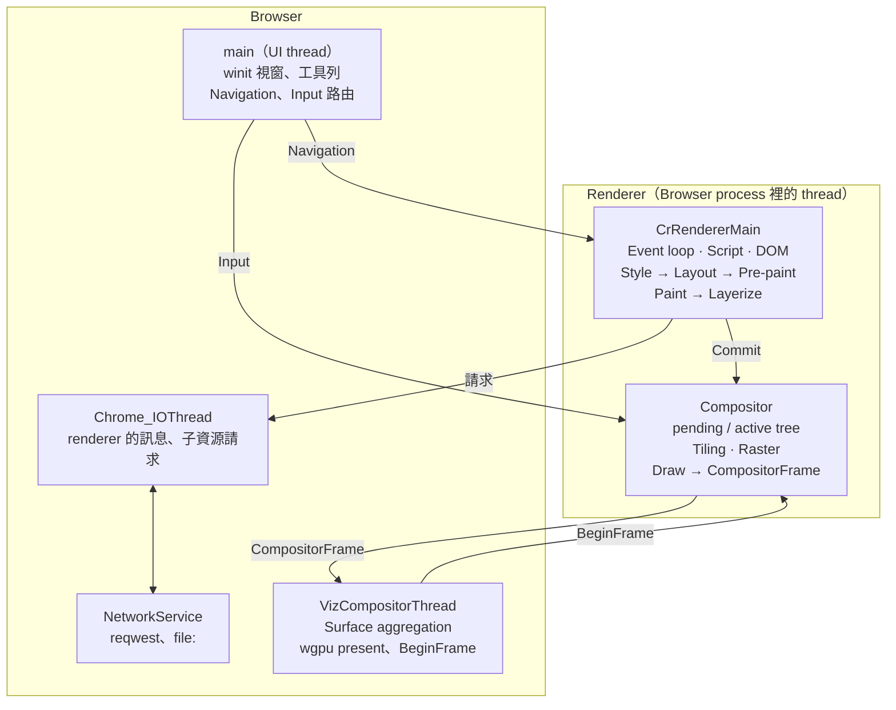

# 架構

machopo 現在的架構：process 和 thread、rendering pipeline、各個 crate、用了哪些第三方的 crate，以及刻意和 Chromium 不同的地方。這份描述目前的樣子和這樣設計的理由。各 crate 的 API 和使用規則見它自己的 README。

## Process 和 thread

一切都在一個 process 裡：Chromium 的 Renderer process 現在是 Browser process 裡的兩條 thread（之後拆成獨立的 process）。Renderer 裡有 main thread 和 compositor thread（cc），raster 在 compositor thread 上；Browser 端負責 UI、網路和最後的合成（Viz）。這和 Chromium 的分工相同，也是和 Servo 最大的不同。

Input 和 `BeginFrame` 先到 compositor thread：它能處理的捲動不經過 main thread，其他的 input 再轉給 main thread。

| Thread | Chromium 對應 | 做什麼 |
| --- | --- | --- |
| `main` | `CrBrowserMain` | winit event loop、視窗、UI（工具列和 Browser 的 compositor） |
| `VizCompositorThread` | 同名 | Surface aggregation、wgpu present |
| `CrRendererMain` | 同名 | 每個分頁一條。V8、event loop（只等它的 scheduler：`task_queue::MainThreadScheduler`）、pipeline、compositor 的 main 端（`LayerTreeHost<ProxyMain>`，在 frame 的 widget 裡）。stack 8 MiB（Chrome 在 Linux 上的；style、layout、paint 每一層遞迴一次，幾千層的巢狀才夠用） |
| `Compositor` | 同名（renderer 的 compositor thread） | 每個分頁一條。compositor 的 impl 端（`ProxyImpl`）：收 Viz 的 `BeginFrame` 和 Browser 的 input（分頁隱藏時不要 `BeginFrame`）：自己捲 viewport 和成為 layer 的捲動容器（滾輪），範圍裡的滾輪（沒成為 layer 或被蓋到的容器，和 wheel event handler region：有 blocking `wheel` listener 的元素）、滑鼠事件和按鍵轉給 main thread（帶著最後畫出的 document 和還沒交出去的捲動；自己捲了的滾輪，頁面有 `wheel` listener 時也轉過去，只分派、不能取消，`InputDispatch::NonBlocking`）、自己回 ack、向 main thread 要 main frame、commit 建 pending tree、raster、activate、draw、送 frame 給 Viz；只等一條 task queue |
| `CompositorTileWorker1` 起 | 同名（cc 的 raster worker） | 只有 `--num-raster-threads N`（N 大於 1）時：每個分頁一組（rayon 的 pool，第一次有兩個以上的 tile 要 raster 時才建）。compositor thread 把要 raster 的 tile 交給它們、等全部做完（raster 到每條 thread 重複用的 buffer、掃單色、上傳到 GPU 或複製出要留的像素），再照順序編 resource id。預設沒有（1 條：在 compositor thread 上 raster）：tile 多的頁面改大小時快好幾倍，但頁面跑的時候它們搶 main thread 的 CPU、多用記憶體（Speedometer 時間約多 1%、記憶體依頁面多到兩成）。Browser 的 UI 的 compositor 一律在自己的 thread 上 raster |
| `CanvasRaster` | （GPU process 裡重播 canvas 的 `RasterDecoder`） | 每個分頁一條，第一個 canvas 交出錄製時才建。持有 canvas 的 bitmap（`willReadFrequently` 的、`getImageData` 讀回兩次之後搬回 main thread 的除外），照 FIFO 重播 main thread 送來的錄製、做快照；不等任何人（送來的只引用它先收到、已經做好的快照），所以不會和其他 thread 互相等待。main thread 讀像素時等它的快照，送得太多時等它趕上（script 中途沒畫的 op 合計 100,000 個、落後 2 個 frame）；compositor 和 raster worker 等快照填好 |
| `CanvasEncoder` | （Blink 的 `CanvasAsyncBlobCreator`：PNG 在 main thread 的 idle task 裡分段編，JPEG 交給 worker thread） | 每個 renderer 一條，第一次 `toBlob` 時才建。照 FIFO 編 main thread 在呼叫時拿的快照（canvas raster thread 上的 bitmap 的快照由它等，main thread 不等），編好的檔案照順序排回 main thread 的 task queue，在那裡變成 `Blob`、呼叫 callback。`toDataURL` 照規範同步回傳，在 main thread 上編 |
| `Chrome_IOThread` | 同名 | Renderer → Browser 的訊息先到這裡，再轉給 UI thread；renderer 的 channel 關閉時報告 `RendererGone`；renderer 的子資源請求在這裡直接交給 `NetworkService`，載入停在 redirect 時告訴 renderer（`ReceivedRedirect`），renderer 回答 `FollowRedirect` 才繼續 |
| `NetworkService` | Network Service（in-process 時跑在自己的 thread 上） | 所有載入（`net`），上面跑 tokio runtime |
| `AutomationPipeReader`、`AutomationPipeWriter` | `DevToolsPipeHandler` 的讀、寫 thread | 只有 `machopo --automation-pipe`：從 stdin 讀自動化的訊息交給 UI thread，把回答和事件寫到 stdout，每則之後接一個 NUL |
| `DevToolsHandlerThread` | `Chrome_DevToolsHandlerThread`（`DevToolsHttpHandler`） | 只有 `--remote-debugging-port`：單 thread 的 tokio，HTTP 的 `/json/*` 和 websocket；請求和每條連線的訊息交給 UI thread 的 session，回答和事件經過連線的佇列送回去 |
| `Automation` | （interactive_ui_tests 的測試本體） | 只有 `machopo --automation` 和情境測試：情境的執行器，經過 channel 送自動化的訊息給 UI thread 上的 host、讀它的回答（只留一個 host、一套協定，情境也是自動化協定的回歸測試） |

Renderer 的 compositor 直接把 frame 送給 Viz，不經過 Browser，這點和 Chromium 相同。

**machopodriver** 是另一個 process，對應 chromedriver：它提供 WebDriver 的 HTTP API（`WebDriverServer` thread，hyper 和單執行緒的 tokio），依序處理指令（`WebDriverDispatcher`），每個 session 啟動一個 `machopo --automation-pipe`，經過 stdin 和 stdout 送照 CDP 格式的訊息（`protocol::automation`，讀的是 `MachopoPipeReader`）。machopo 和 machopodriver 之間不是 renderer 的邊界：訊息只到 Browser 的 UI thread，要 DOM 的（執行 script、找元素、讀元素，`protocol::webdriver`）再由 Browser 經過 `protocol` 的 renderer 訊息轉過去，renderer 在 main thread 上照規範的演算法做（不注入 JS），元素參照是 renderer 的前綴、document 的 id 和 `NodeId` 拼成的字串，不存表；在子 frame 裡做時帶 frame 的 id（renderer 的前綴和 frame 的號碼，frame 導覽時不變，Chromium 的 frame token），找 frame 走 frame tree。情境的執行器用同一套訊息、同一個 host（`automation_session`），在同一個 process 裡經過 channel。machopo 的 log 和網頁的輸出（`console.log`、沒接住的例外）因此都在 stderr：stdout 是 pipe 的。

### Process 的邊界

Renderer 是 Browser process 裡的 thread，但程式照 process 的邊界寫：之後拆開時，renderer 這一側的程式不必改。Chromium 的 `--single-process` 也是這樣（renderer 是 thread，訊息照樣走 Mojo），邊界靠 `DEPS` 和 `checkdeps` 守住；machopo 用 `python3 scripts/sanity.py boundary` 和 `protocol` 的 `boundary` 測試。

**規則**（1 到 5 是 renderer 這一側的，6 是收的一方的；renderer 這一側是：`renderer`、`compositor`、`compositor_paint`、`raster`、`paint`、`layout`、`style_resolver`、`style`、`html`、`computed_style`、`bindings`、`dom`、`dom_api`、`dom_api_macros`、`dom_js`、`dom_wasm`，和兩邊都用的 `gfx`）：

1. **不依賴 Browser 這一側的 crate**（`browser`、`net`、`viz`、`shell`）。renderer 不碰檔案系統和網路：頁面和子資源都經過 Browser 的 `net`。碰 Viz 只經過 Browser 綁在自己的 `FrameSinkId` 上的 `CompositorFrameSinkSender` 和訊息：程式裡不出現 `VizMsg`，不向 Viz 登記 context lost 的 observer（GPU 遺失由 Browser 用 `CompositorMsg::ContextLost` 轉告）（`sanity.py boundary`）。
2. **跨邊界的只有 `protocol` 的 message**（`RendererMsg`、`RendererHostMsg`、`CompositorMsg`、`CompositorFrameSinkMsg`、`VizMsg`），都能序列化（`cargo test -p protocol --test it boundary::`）。
3. **`protocol` 裡沒有不能跨 process 的東西**：`#[serde(skip)]`、trait object、`Weak`、closure、函式指標，除了下面列的例外（`sanity.py boundary`）。
4. **renderer 這一側沒有整個 process 共用的可變狀態**：`static` 的 `Mutex`、`LazyLock`、`OnceLock`、atomic 等，除了下面列的例外（`sanity.py boundary`）。thread-local 的不算：每個 renderer 的 thread 各一份。elise（DOM 的 GC，machopo 旁邊的專案，這個檢查看不到）有幾個：型別表和它的下一個編號、配置的地方（`Site`）的下一個編號，都是程式碼的東西，每個 renderer 都一樣（執行時登記的型別由 embedder 為每個 engine 保留一段編號）；預設的 worker pool，拆成 process 之後每個 process 一組。
5. **啟動 renderer 時給的東西**只有能序列化的值（`RendererFlags`，`renderer` 的單元測試在編譯時確認）和 channel 的一端（`RendererEndpoints`）；script engine 由啟動的一方另外給（`ScriptEngineFactory`：建 engine（`dom_api::ScriptEngine`，例如 `dom_js::V8Engine`）的函式，在 renderer 的 main thread 上、第一份文件時建；相當於 child process 的 `main` 自己選）。`RendererEndpoints` 只放 channel 這一條靠審查。
6. **Viz 不信任 renderer 送來的資料**：`Display::submit_compositor_frame` 驗證帶像素的 resource（大小不超過 `protocol::viz::MAX_TEXTURE_SIZE`、像素的長度等於 checked 的寬 × 高 × 4，`pixels_fit`），不合法的整個 frame 丟掉；`create_shared_image` 照同樣的檢查。新的訊息欄位也要在收的一方驗證（大小、索引、長度），之後拆成 process 時，不合法的訊息照 Chromium 的 `ReportBadMessage` 結束那個 renderer。

**例外**（修好一個就從 `sanity.py` 的允許清單和這裡拿掉；編號和 `sanity.py` 的一致，2 到 6 已經修掉或不再算例外）：

| # | 例外 | 什麼時候修 |
| --- | --- | --- |
| 1 | compositor 同步呼叫 Viz 的 `SharedImageInterface` 建 tile 的 texture；`SharedImage` 的 backing 是 `Arc<dyn Any>`，tile 的生命週期靠參考計數 | 拆 process 時（mailbox 的表、`ReturnResources`） |

不算例外的：`BeginFrame` 由 Viz 呼叫 Browser 給的 closure 送進 compositor（closure 在 Browser 裡建、只送一則 `CompositorMsg`，拆 process 時由 `RenderProcessHost` 改成寫進控制通道，renderer 不必改）；`TransferableResource::pixels`（`Arc<[u8]>`）和導覽的 body（`Vec<u8>`）能序列化，跨 process 時只是要複製；`CopyOutputRequest` 的 callback 和 `BeginFrameObserver`（Browser 在執行中向 Viz 登記分頁的 frame sink 時給的 closure）在 Browser 和 Viz 之間，Viz 留在 Browser process；display list 帶著的 `gfx::FontData`、`ImageData` 只有 raster 搬出 renderer（OOP-R）時才跨邊界；V8 的 platform、id 的計數器、trace 有沒有在錄的旗標（`bindings::trace::recording()`：trace 是整個 process 的）每個 process 一份是對的；`browser` 依賴 `renderer` 只為了開 thread（Chromium 的 `InProcessRendererThread`）；`MessagePort` 的訊息直接排進同一個 renderer 裡的對方的 task（Chromium 經過 mojo 的 pipe）：port 只能 transfer 給同一個 renderer 碰得到的 window，跨 renderer 的 port（跨 process 的 iframe、worker）出現時才要經過 Browser 的通道；依賴同一個 process 的測試（`DrivenViz`、headless、`FakeGpu`）是刻意保留的。

## Rendering pipeline

每個階段都對應到 Chromium 裡的一個元件，輸出的資料結構也相同，差別只在實作的完整度。

| 階段 | Thread | Chromium 對應 | crate | 輸出 |
| --- | --- | --- | --- | --- |
| 1. Parse | Main | `HTMLDocumentParser` / `HTMLTreeBuilder` | `html` + `dom` | DOM tree |
| 2. Style | Main | `StyleEngine` | `style` | 每個 element 的 `ComputedStyle` |
| 3. Layout | Main | LayoutNG | `layout`（taffy + parley） | Immutable fragment tree |
| 4. Pre-paint | Main | `PrePaintTreeWalk` | `paint` | Property trees（transform / clip / effect / scroll） |
| 5. Paint | Main | `PaintArtifact` | `paint` | Display items + paint chunks |
| 6. Layerize | Main | `PaintArtifactCompositor` | `paint` → `renderer` 的 `compositing.rs` | cc layers 和 compositor 端的 property tree |
| 7. Commit | Main → Compositor | `LayerTreeHost` → `LayerTreeHostImpl` | `compositor`（`ProxyMain` → `ProxyImpl`） | Pending tree |
| 8. Tiling / Raster | Compositor | cc `TileManager` + Skia（OOP-R） | `compositor` + `raster`（vello_cpu） | Tile（視窗模式是 Viz 的 GPU device 上的 texture） |
| 9. Activate / Draw | Compositor | cc active tree | `compositor` | `CompositorFrame`（RenderPass + DrawQuad） |
| 10. Aggregate / Present | Viz | `SurfaceAggregator` + `SkiaRenderer` | `viz`（wgpu；沒有視窗時畫進自己的 texture） | 畫面 |

DOM 改了之後，每個階段都只重做受影響的部分（節點層級的 dirty flag、局部重排、沿用沒變的 display item、只重新 raster 變了的 tile）。

## Crate

路徑都在 `crates/` 底下，package 名稱和目錄名稱相同。

| Crate | 對應 Chromium | 目前狀態 |
| --- | --- | --- |
| `shell` | `//chrome/browser/ui` | `BrowserView`（分頁列、工具列和網頁 view，Browser 的 compositor、hit test 和 input 的分配、快捷鍵；哪個網頁有 system focus：有按鍵的網頁 view，視窗是 active 的、網址列沒有按鍵時，`WebContents::set_focus` 告訴它的 renderer；`keyboard` 把平台的按鍵換成 DOM 的 `key`、`code`、`keyCode`，快捷鍵以外的都送給網頁，Tab 在網址列和網頁之間交換 focus；`mouse` 照系統的連按間隔算連點的次數，視窗在送出按下時算）、`BrowserViewLayout`（分頁列、工具列和每個網頁 view 的 bounds）、`TabStripModel`（分頁和目前的分頁；連結開的分頁記住打開它的分頁）、分頁列（`TabStrip`，和工具列畫在同一個 layer）、sad tab（`SadTab`，renderer 當掉的網頁 view 的 picture layer）、收起來的 `<select>` 的下拉清單（`popup_menu`，Chrome 的 `PopupMenuHelper` 顯示 `ExternalPopupMenu` 的做法：renderer 送 item 和位置，Browser 畫在視窗的最上面、收它的滑鼠和按鍵，再把結果送回）、UI 的文字（`ui_text`：字型、一行的標籤、glyph）、工具列和網址輸入框（過渡的原生 UI）、網址的補全、`BrowserWindow`（tab、Viz thread 和 `BrowserView`，視窗和情境測試共用；`content::Shell`）、視窗（winit 事件的轉換）、headless 模式（端到端的測試用它）、參數解析、情境的格式和執行器、`MACHOPO_TRACE` 的 trace（`trace`，Chrome 的 `--trace-startup-file`）、`machopo --automation-pipe` 的 pipe（`automation_pipe`，`DevToolsPipeHandler`）和處理自動化訊息的 host（`automation_session`，`DevToolsSession` 和它的 `Target`、`Page`、`Browser`、`Network`（導覽的事件、cookie 和 cache 的命令）、`Log`（警告）handler，它不處理的分頁的命令照原樣交給 renderer 的 inspector（標著哪些要打斷跑著的 script，記著還沒回答的），renderer 的回答檢查過才給 client）、平台的 system color（`system_colors`：Windows 上從 registry 讀系統色，視窗的 renderer 用它，headless 和用測試字型的視窗用預設的表）（lib + `machopo` bin） |
| `browser` | `//content/browser` | `user_agent`（UA 只有一個來源：照 Chrome 的 reduced UA，版本是連結的 V8 的 milestone；交給 `net` 和 `RendererFlags`）、`WebContents`（非同步的 navigation，開始時記下時刻、commit 時告訴 renderer 過了多久（新文件的時間原點）、renderer 要開的網址的檢查、renderer 當掉後在下一次導覽時重開；導覽的載入停在 redirect 時，在 UI thread 上決定繼續（Chromium 的 `NavigationRequest::OnRequestRedirected`），載入完成或失敗時也在 UI thread 上叫 renderer commit（文件或錯誤頁，`OnResponseStarted`），新的導覽開始時取消舊的；renderer 的訊息和導覽的事件經過外層程式給的同一個 callback（`ContentsEvent`）轉到 UI thread，導覽的事件不是 renderer 的訊息、renderer 送不出來；分頁一建立就抽 DevTools 的 frame token（target id，也是 main frame 的 id；Chromium 的 `devtools_frame_token`），每次啟動 renderer 都交給它；DevTools 的 session 接上、拿掉和訊息交給 renderer）、debug URL（`about:gpucrash`、`about:crash`，只在使用者自己導覽時）、`NavigationController`（session history；`location.replace` 和文件載入完之前的導覽取代目前的 entry，同一份文件內的也可以；每個 entry 記得它是哪份文件的（commit 那份文件的 `navigation_id`，Chromium 的 document sequence number）、序列化的 `history.state` 和捲動恢復的模式；上一頁、下一頁到同一份文件的 entry 時送 `CommitSameDocumentNavigation`，renderer 已經換了文件時（`SameDocumentNavigationFailed`）改成載入，跨文件的 commit 帶著 entry 的 state、index 和 length，commit 之後再送 `SetHistoryOffsetAndLength`；`GoToEntryAtOffset`、`UpdateState`）、`RenderProcessHost`（thread；子資源請求和讀本機檔案的權限；IO thread 收 renderer 的 blob URL 登記、當場回應 `blob:` 的子資源，撤銷先在 IO thread 標記、再交給 UI thread 拿掉，renderer 結束時拿掉它所有的網址）、導覽到 `blob:` 時當場從 `net` 的 blob URL 表拿、`LocalSurfaceId` 配置、`about:` 頁面和錯誤頁 |
| `protocol` | `.mojom`；`browser_protocol.pdl` | Browser / Renderer / Viz 之間的 message 和 `CompositorFrame` 型別；Fetch 的 header list 的演算法（`header_list`，DOM 的 `Headers` 用它）；`automation`：驅動 Browser 的訊息（`machopo --automation-pipe`），照 CDP 的格式和方法，CDP 沒有的在 `Machopo` domain；`webdriver`：WebDriver 在 renderer 裡的工作（執行 script、找元素、讀元素）和它的值、錯誤（chromedriver 注入的 JS 做的事） |
| `driver` | `//chrome/test/chromedriver` | machopodriver：WebDriver classic 的 server，HTTP 用 hyper，指令的解析、型別和 capabilities 用 `webdriver` crate（不用它的 server），每個 session 一個 `machopo --automation-pipe`；lib（`driver::start`，shell 的測試在 process 裡用它）加 `machopodriver` bin |
| `renderer` | `//content/renderer` | Event loop（一個 scheduler，`task_queue::MainThreadScheduler`，Blink 的 `MainThreadSchedulerImpl` 和它的 `SequenceManager`：照來源分成幾個 task queue（Browser 的訊息、rendering（compositor 要的 main frame 和 Browser 要的 frame，`RequestVisualState`）、轉過來的 input、DevTools 的訊息、canvas 的檔案），一把鎖，每個 task 送進來時拿一個遞增的序號，取時在允許的 queue 裡取最早的：loop 取全部，照送進來的順序；script 停在斷點時只取 DevTools 和 rendering 的，其他的留著；轉過來、還沒處理的 input 照對象計數（`PendingUserInput`，Blink 的 `PendingUserInput::Monitor`：compositor 交出時加、main 取出時減，合併的 `mousemove` 到分派時才減），`isInputPending()` 經過 engine 的 `InputMonitor` 讀它（renderer 在最上層的文件 commit 時給，帶著畫的文件，子 frame 的文件是它的 element id）；DOM 的 task（timer、UA 自己的 timer、idle callback 的 timeout、element task（window 的 `load` 也是，DOM manipulation 的 task）、`postMessage` 和 port 的訊息）照一個共用的先後跑（`ScriptEngine::run_due_tasks`，`dom` 的 `tasks`：每個 task 排進來（timer 在設定和 interval 重新排時）就從 `Dom` 上的計數器拿一個編號，所有 window 和佇列裡挑 `(可以跑的時間, 編號)` 最早的一個，每次重讀時鐘；Chromium 的 `SequenceManager` 照 `EnqueueOrder` 挑），一輪只跑這一輪開始前就排好的（互相 postMessage 的頁讓給畫面和輸入）；loop 的每個 task（輸入、Browser 的訊息）之後，`Dom` 的「可能有排著的」旗標有設時就跑一輪（輸入觸發的 `hashchange` 在下一個輸入之前跑），沒有時只讀一個 bool；realm 登記的 blob URL（`BlobUrls`：登記當場告訴 Browser，撤銷在 renderer 當場生效、這一輪 loop 結束才告訴 Browser；照 engine 的 frame 記，engine 經過 renderer 給的 load sink（`RendererLoadSink`）在 script 呼叫當下登記、撤銷，frame 換文件、不在了時撤銷；撤銷了的 blob URL 的圖和 `fetch()` 不送出請求；圖和 script 開始抓之前先處理 engine 的 frame 請求，task 裡登記的 blob URL 在抓它之前告訴 Browser）；`requestIdleCallback` 的 idle period（經過 engine 的 `start_idle_period`、`run_idle_callback`）：queue 空了時一次跑一個 callback，正在畫時到上一個 main frame 加一個 frame 的時間為止，沒有要畫時最長 50 ms，Blink 的 `IdleHelper`；給了 `timeout` 的到期時當 timer 跑，和 timer 照到期時間交錯；engine 的 platform task，之後一次 microtask checkpoint）、時鐘（`Clock`：timer、animation frame 和 `performance.now()` 共用；每份 document 的時間原點是它的導覽開始的時刻，主 frame 的由 `CommitNavigation` 帶來（browser 的 `ipc::TimeTicks`，和載入的時間一樣：不是送出時算好的「多久之前」，那會晚了 commit 在 renderer 的佇列裡等的時間），子 frame 的是它的 `src` 開始抓的時刻）、navigation timing（`navigation_timing`，Blink 的 `DocumentLoadTiming`：網路的時間，主 frame 的來自 `CommitNavigation` 的 `NavigationLoad`（browser 收集的每一跳 redirect 和最後的 `LoadTiming`、導覽的種類），子 frame 的來自自己的載入和 redirect，在 commit 時算好交給 engine（`ScriptEngine::set_navigation_timing`，window 的 time origin 以來的毫秒）；文件的那一半由 DOM 自己記）、input 的 ack（處理期間要求了 main frame 才等那個 frame；滑鼠移動在下一個 main frame 分派之後才 ack；隱藏的分頁不等，排著的移動當場分派）、`BeginMainFrame`（排著的 `mousemove`、autofocus candidate、捲動的 `scroll` 事件（HTML 的 scroll steps）、media query 的 `change`（`ScriptEngine::report_media_query_changes`）、transition 和 CSS 動畫往前走和它們的事件、animation frame callback（`ScriptEngine::run_animation_frames`），之後 `ResizeObserver` 的迴圈、focus fixup 和分頁的標題；有要畫的才做 rendering update，以 commit 或 abort 結束；`DidFinishLoad` 和 `ReftestWaitEnded` 是 swap promise）、建立 compositor thread、文件的 lifecycle（`FrameView`，Blink 的 `LocalFrameView`：每個 frame `style` 的 style、`layout` 的 `update` 和 layout、pre-paint、paint 和 compositor 的 layer，只跑 dirty 的階段，樹的版本變了、載入完時要 frame；pre-paint 是單獨的一步，輸入和 script 的 hit test 先更新到它；畫成被選到的文字和游標（`selection`，Blink 的 `LayoutSelection`、`FrameCaret`：有 focus 的文字控制項的選取，否則 document 的 `Selection` 的 range 經過的文字和 ` `，有 focus 的 editing host 裡收合的選取的游標），變了的 block 重畫、不重新 layout；游標的閃爍是 render_thread 的計時器（`RendererFlags::caret_blink_interval`，亮暗各一個間隔，Blink 的 `caret_blink_timer_`），page 有 focus 時才閃；背景圖照 style 找到的網址向 DOM 的圖片清單要，還沒到的記著元素，到了時重畫；frame view、thread 的 `LocalToken` 和 `TextContext` 是一個 `Frame`，engine 拿著（`dom_api::FrameLayout`，render thread 經過 `ScriptEngine::dom_and_layout` 用它跑 lifecycle），script 讀 geometry 的成員在自己的操作裡借它更新 style 和 layout（Blink 的 `UpdateStyleAndLayoutForNode`）；視窗的大小和 scale 在 commit 和每次改變時就交給它，變了時、子 frame 換了大小時對那份文件 react to environment changes（`` 的 `srcset`、`<picture>` 重新選來源））、文件的載入（`render_thread::next`：導覽的 body 交給停在 script 的 parser（`html::parser::Parser`），擋住 parser 的和 `defer` 的 classic script 照順序跑（外部的先抓；擋住 script 的 stylesheet 還在載入時不跑，HTML 的「a style sheet that is blocking scripts」：parser 的 `<link>`、開始載入時 media 符合的，script 拿掉它或改得不是 stylesheet 之後就不再擋，每輪 loop 之後再試；inline script 的 base URL 是 prepare 時 document 的 base URL），module script 的 graph 由 engine 抓、link、執行，DOM 排著、不等 parser 的外部 script 照 `Dom::take_script_fetches` 抓；`<link rel=stylesheet>` 由 render thread 載入（parser 停下時和 DOM 變了之後找，不是 alternate 的擋住 render，window 的 `load` 等它們，link 上觸發 `load` 或 `error`）；DOM 的圖片清單等著的圖照 `Dom::take_image_fetches` 抓（renderer 一份，Blink 的 memory cache），照 `no-cors` 請求、帶 document 的 origin；`fetch()` 在呼叫當下由 load sink 送出（Blink 的 `FetchManager::Loader`，`dom_api::LoadSink`：和 blob URL 的撤銷照呼叫的順序；送了什麼之後經過 `FrameRequest::FetchSent` 告訴 render thread，回應來時先處理 frame 請求），回應在一個 task 裡交回，abort、它的文件不在了或被丟棄（iframe 拿掉、換了文件）時取消；`DOMContentLoaded` 和 `load`（等子 frame、sheet、延後它的圖之後，window 的 `load` 排成 DOM manipulation 的 task，排在之前的 element task 後面，它跑完（`Dom::take_loaded_documents`）才觸發 iframe 的 `load`、告訴父的和 DevTools，子 frame 在那之前照樣延後父的 `load`）；載入失敗或內容不能用的子資源（圖解不開、不是 JavaScript 的 script、`href` 解析不了的 `<link>`）和 `DidFinishLoad` 一起告訴 Browser）、滾輪（`wheel` 事件交給 engine（`ScriptEngine::handle_wheel`），沒被取消、compositor 交給 main thread 的才由 `FrameView` 捲，compositor 自己捲了的只分派；wheel event handler region 照 paint 的 hit test data（`style` 給有會阻擋的 listener 的元素和它下面的 `inside_blocking_wheel_event_handler`），`dom` 的 wheel listener 版本號變了、沒有要重新 paint 時只重算區域、沿用同一批 layer）、捲動（`scroll`：compositor 轉過來的捲動容器上的滾輪和 `#fragment`：找捲動容器、往外傳，子 frame 的 scroller 傳到父的，每一層的計算用 `compositor` 的 `ScrollNode`；套用 compositor 捲的 viewport 和容器的位移，子 frame 的交回各自的 view，已經不是 layer 的容器重新 paint；script 的捲動照同一個 `ScrollNode` clamp；`scrollIntoView` 和 `#fragment` 照 Blink 的 `ScrollRectToVisible` 對齊每個捲動框；捲動了的目標記下來，下一個 `BeginMainFrame` 分派 `scroll`（`FrameView::take_scroll_events`））、paint 的 layer 轉成 compositor 的 layer 和 property tree（`compositing.rs` 的 `PaintArtifactCompositor`：layer 保有 id、帶要重新 raster 的範圍，沒變的沿用 display list；`PropertyTreeManager`）、滑鼠和按鍵（compositor 轉過來的交給 engine（`ScriptEngine::handle_mouse`、`handle_key`：hit test、hover 和 active、邊界事件、focus 的移動、連結、游標的樣子（Blink 的 `EventHandler::SelectCursor`：`cursor` 的 keyword，`auto` 是連結上的手形、能選的文字上的 I-beam、其他的箭頭）和按鍵的捲動（從有 focus 的元素、沒有時從滑鼠上次按下的地方往外，經過 `FrameLayout::keyboard_scroll` 捲第一個能動的 box，Blink 的 `ScrollManager::LogicalScroll`）都在 `dom_api` 的 `EventHandler`，一層一層往下交給子 frame），移動留到下一個 frame，DOM 變了就要 frame；游標變了才送 `SetCursor`，新的 document 回到箭頭；commit 的 pre-paint 變了（layout、捲動、style）時，在指標停著的地方重找它底下的東西（`recompute_under_mouse`：邊界事件和游標，不發 `mousemove`；Blink 的 `RecomputeMouseHoverState`）；input 要的 navigation 在它的 ack 之前處理；`<select>` 的下拉選單由 Browser 畫（Blink 的 `ExternalPopupMenu`），結果交回 engine）、focus（Browser 的 `SetFocus`、`SetInitialFocus` 交給 engine，engine 還沒建時 render thread 先記著；Tab 過了頭尾送 `TakeFocus`）、導覽（script 的導覽，`dom::FrameNavigation`：最上層的 frame 到別的文件、reload、`history` 的 traversal 和 `scrollRestoration` 交給 Browser（它的 session history，Blink 的 `LocalFrameHost`），子 frame 的在這裡載入；同一份文件內的捲到 fragment，最上層的告訴 Browser（`DidCommitSameDocumentNavigation`）；Browser 的同一份文件內的 traversal（`CommitSameDocumentNavigation`）交給 engine；`javascript:` 的網址在那個 frame 跑；連結開的新分頁由 Browser 開）、rendering update 的步驟照 frame tree 的文件的 tree order（rAF；`ResizeObserver` 每份文件的迴圈（`ScriptEngine::gather_and_broadcast`），有略過的發 loop error、下一個 frame 送；focus fixup；`IntersectionObserver`：pre-paint 重跑過、有新的 observation，或有 observer 追蹤可見時 paint 過時，在最上層的 viewport 裡經過 `paint::intersections` 一次算完、照 window 交回（`dom_api::update_intersections`，一個 task 遞送），跨 origin 的不給 root 的 margin 和 bounds，離上次算不到 observer 的 `delay` 的跳過、最早到期的時間到了要 frame），`postMessage` 和 port 的訊息是 window 的 task，和其他 DOM 的 task 照共用的先後跑）、page 的可見性（Browser 的 `WasHidden` / `WasShown`，所有 frame 共用，變了時每份文件跑 HTML 的 update the visibility state（`ScriptEngine::set_page_visible`，分派 `visibilitychange`），Blink 的 `Page::SetVisibilityState`；背景開的分頁在 commit 任何東西之前就收到 `WasHidden`）、document（每份 commit 的 document 一個 `DocumentId`，compositor、捲動和輸入用它判斷是哪份）、frame tree（子 frame 的 `FrameView` 掛在父的下面（整棵 frame tree 一個 `Frame`），照 iframe 的內容框 style、layout，和父的一起 pre-paint、paint；render thread 照 engine 的 `FrameRequest` 載入子 frame（`src` 照 `RequestDestination::Iframe` 抓，失敗的 commit 成空的文件；`srcdoc` 和 `about:` 的文件不用抓，照樣在自己的 task 裡 commit，像回應來了一樣；初始的 `about:blank` 也是一份載入完的文件，script 插進去的 script 和 `<link>` 照樣載入），子 frame 載入完之前父的 `load` 等著，`ChildFrames`；子 frame 的文件等著擋住 render 的 sheet 時不 style、不 layout，照上次的畫，viewport 照樣跟著 iframe 的大小（media query 看到的））、stylesheet 和 script 的解碼（`encoding`）；分頁的標題：每個 task 之後，以及 `BeginMainFrame` 的 animation frame callback 之後、commit 之前（frame 的 swap promise 在它之後才到 Browser），tree 變了之後讀 `<title>`，和上次送的不同才送 `UpdateTitle`；canvas（`canvas`）：2D context 錄下的 op 在 rendering update 之前（顯示的文件裡的 canvas）、script 讀像素時（`FrameLayout::flush_canvas`）、錄太多時交給 canvas raster thread（`canvas_raster`，Chromium 加速的 canvas 交給 GPU process 重播）：它持有 bitmap，照送來的順序畫（`putImageData` 也是一個 op，`PaintOp::WritePixels`），一個 frame 的 canvas 是一批，快照（`gfx::ImageData::pending`）由它填像素、和 bitmap 共用到下一次畫（copy-on-write）；compositor 上傳 texture、tile 的 raster 讀快照的像素前等它（`wait_ready`，Chromium 的 sync token），`getImageData`、`toDataURL`、`toBlob` 在 main thread 上等（`toBlob` 的檔案在 `CanvasEncoder` thread 上編），canvas 當 `drawImage` 和圖案的來源時錄的是快照、不等；`willReadFrequently` 的 canvas 照舊在 main thread 上畫（Blink 的 `kPreferCPU`），`getImageData` 讀回 2 次的 canvas 搬回 main thread、之後在那裡畫（`canvas` 的 `pixels` 把剛讀的快照的像素留在 `CanvasData`，Blink 的 `kFallbackToCPUAfterReadbacks`）；context 不在了的 bitmap 在下一個 frame 釋放；所有 canvas 共用一份 `RasterCache`，用過的 typeface 跨 flush 留著；畫過的 canvas 是 layer 時只換它的 `TextureLayer` 的快照、不重新 paint（Blink 的 composited canvas；它的 display item 留著舊的快照，標起來在下一次 paint 時重畫），不是 layer 時重新 paint，都不重新 layout；沒有東西可顯示（reset 之後的透明畫布）的 canvas 沒有 layer；canvas 被畫過時要求 main frame（DOM 沒變也一樣）；SVG 圖片（`svg_image`，Blink 的 `SVGImage`）：`image/svg+xml` 的 response 解析成網頁的 DOM 裡一份沒有 window 的文件（frame 的 `SvgImages` 照編號留著，DOM 的圖片清單記著編號和 natural size），style 一次，照每個顯示它的框或背景的圖塊的大小 layout、paint、攤平成一個 display list（`SVGImageForContainer`），有固有大小時照它排版、再縮放；paint 問到還沒畫的大小時，畫好之後讓問的元素再 paint 一次；DevTools 的 session（`render_thread/devtools`，Blink 的 `DevToolsAgent`：Browser 接上、拿掉的 session，renderer 的 agent 回答它們有的，其他的命令交給 engine 的 inspector（`ScriptEngine::dispatch_devtools_message`，一個 task，之後一次 microtask checkpoint；engine 還沒建時當場建，建的時候接上所有的 session），engine 沒有的回答找不到方法；每個 frame 的 realm 帶著 frame 的 DevTools id 告訴 inspector（`ScriptEngine::set_devtools_frame_ids`），frame 換 realm、不在了時告訴它不在了，main frame 導覽時一次清掉；main loop 等 task 時告訴 engine 閒著（`ScriptEngine::set_idle`，`Profiler` 的 `(idle)`））、`Page` agent（`render_thread/page_agent`，Blink 的 `InspectorPageAgent`：frame 樹和每份文件載入的子資源（`FrameResources`，不管 DevTools 在不在都記，記在 render thread 的文件上、和告訴 agent 的那份共用，之後再變時才複製）、文件的原始碼和 `Network` 留著的子資源的 body、frame 的事件（script 建的 iframe 帶著建它的 stack）、每個 frame 的生命週期事件（`DOMContentLoaded`、`load`、停止載入；`networkIdle` 由每份文件的 `idleness_detector` 算，Blink 的 `IdlenessDetector`，render thread 在每個 task 之後數進行中的請求），machopodriver 的 navigate 等的是它）、`Network` agent（`render_thread/network_agent`，Blink 的 `InspectorNetworkAgent`：renderer 送出的請求（子資源、`fetch()`、iframe 的文件；`render_thread/next` 送出時先問有沒有 session 打開 `Network`，沒有就什麼都不看）從哪個 frame、哪份文件送、誰發起的（`initiator`：parser 建的元素是它的開始標籤的那一行（`Parser::take_load_lines`），stylesheet 的 `url()` 是那份 stylesheet，module 的 import 是 import 它的 module，script 要的帶 script 的 stack），redirect、結束和失敗，主 frame 的導覽的結束和它的文件的 body，給打開 `Network` 的 session，每個 session 各自留著；script 的 stack 由 engine 抓：DOM 在 operation 裡記下要載入的元素和 `fetch()`（`dom::StackAsker`），operation 結束時 engine 抓一次（operation 裡不能配置 V8 的物件），請求開始時拿走，沒有被拿走的每輪 loop 結束時丟掉；只在 session 要的時候記（`ScriptEngine::set_stacks_wanted`））、`Log` agent（`render_thread/log_agent`，Blink 的 `InspectorLogAgent`：載入失敗和 400 以上的回應，和 script 的呼叫引起的警告（`Dom::take_console_warnings`，每輪 loop 和 DevTools 的命令之後拿），一律記、印到 stderr，`Log.enable` 時補送）、`DOM` agent（`render_thread/dom_agent`，Blink 的 `InspectorDOMAgent`：每個 session 給送過的節點編號，不在文件的樹裡的留著 root，`backendNodeId` 是 `dom::NodeId`；有 session 打開 `DOM` 時 DOM 記下樹的改動（`Dom::set_dom_changes_wanted`、`take_dom_changes`，`dom` 的 `probe`：每個改動多讀一個旗標），每個 task 之後、回答命令之前和 script 停住時拿走，照那時的 DOM 轉成事件；frame 的 iframe 和文件由 render thread 在每個 task 之後交給它；要 script 的物件的命令（`resolveNode`、`requestNode`、`$0`、`DOMDebugger.getEventListeners`）經過 engine 給的 page 問 inspector（`dom_api::DevToolsPage`、`DevToolsObjects`，`dom_js` 的 `devtools_page`），DevTools 叫節點的名字（Console 的 `div#a.x`）也是 `dom_js` 告訴 inspector 的；盒模型、某一點的節點從 layout 拿（`layout::box_quads`、`border_quads`，換到最上層的 viewport）；元素的 `::before`、`::after`、`::marker` 是 agent 自己編號的節點（machopo 的 DOM 沒有它們），style 在它們的樣式變了時記下（`DomChange::PseudoElements`），agent 在 lifecycle 之後有 layout 時判斷來去、送事件）、`CSS` agent（`render_thread/css_agent`，Blink 的 `InspectorCSSAgent`：computed style 走 `getComputedStyle` 的取值（`dom_api::computed_style_for_devtools`，renderer 把 layout 借給它）；套用的規則問 style（`StyleEngine::explain`：和 cascade 收集 block 的同一段，`Walk::blocks`，重新 match 一次，不設 selector 的 flag、不留快取；另外記下每個 block 從哪個 index 的第幾條來，index 的規則記著它是那一串 stylesheet 的第幾份，找出它的 stylesheet；規則在原文裡的位置：原文用 `css::inspector` 再解析一次，同一個 parser 多一個記位置的 recorder（Blink 的 `CSSParserObserver`），平常解析時沒有 recorder，照規則在 stylesheet 的規則樹裡的位置對到同一條，script 用 CSSOM 改過的 stylesheet 的原文換成序列化的規則（`dom` 記著改過沒有））；字型從文字的 fragment 數 glyph（`layout::platform_fonts`）；Computed 跟著的節點在每次 lifecycle 之後比較 style 的指標，換了就告訴前端；stylesheet 的清單在每次 lifecycle 之後、有文件或 shadow root 重新收集了 stylesheet 時（`StyleEngine::sheets_version`）重新列出，和每個 session 知道的比；`<link>` 的原文在有 session 時留著載入的回應，沒有的要用時照 `<link>` 再抓；`<style>` 的位置從 parser 記下的行和 `Page` agent 留著的文件原文找；元素的 pseudo element 的規則和祖先的規則也問 `explain`，動畫的樣式是每個動畫單獨套在基本樣式上的值（`animation` 的 `ElementAnimations::sampled_alone`），`@keyframes` 照 style 的 tree-scoped 的找法（`StyleEngine::keyframes_rule`）；`forcePseudoState` 強制的 pseudo-class 每個 session 記自己的，合起來寫進 `dom`（`Cx::set_forced_pseudo_classes`，經過 `state_changed` 重算），style 的 matcher 先看一個「有沒有元素被強制」的旗標（Blink 的 `probe::ForcePseudoState`））、`Overlay` agent（`render_thread/overlay_agent`，Blink 的 `InspectorOverlayAgent`：先算出 Blink 交給 overlay 頁面的那份 highlight 的資料（框的路徑和顏色、元素的資訊和樣式），再照 overlay 頁面的畫法自己畫成一個 display list（每個框只畫它和裡面那個框之間的一圈）；commit 時加在頁面的 layer 上面，一個 viewport 座標的 layer，有東西框著時每個 frame 重算、變了才重畫這個 layer；選取元素的模式時滑鼠的事件不交給頁面，交給它）和 DevTools 的 task queue（Blink 的 `InspectorTaskRunner`：停在斷點時 engine 的 inspector 只從它和 rendering 的 queue 等下一個（`ScriptEngine::set_devtools_queue`）；rendering 的是停住時畫的 frame：frame 的 lifecycle、overlay 和 commit，不跑 rAF、ResizeObserver、動畫這些 script 的步驟，畫的狀態（`LayerTreeHost`、上次的 paint、overlay 的 layer、等著 frame 的 promise）在 frame 的 widget 裡（`frame_widget::FrameWidget`，Blink 的 `WebFrameWidgetImpl`，第一份文件之前在 render thread），engine 經過 isolate 借得到；`Page`、`Network`、`Log`、`DOM`、`CSS`、`Overlay` 的命令照樣由 agent 回答：engine 把 page 借給它們（`dom_api::DevToolsPage`：DOM、layout 和 inspector 的物件，停在 JS 的敘述時沒有人借著 isolate 的狀態），停住時也讀得到樹、重算得了 style 和 layout；停住時接上的 session 和它的命令等繼續之後），要打斷 script 的訊息放進來時呼叫 engine 給的 interrupter，在 script 的安全點拿走；`Shutdown` 也放一個 `Quit`，讓停住的 script 繼續到被終止），每個 frame 的 DevTools id（main frame 的由 Browser 給，子 frame 的照 WebDriver 的 frame id）；WebDriver 的命令（`webdriver_commands.rs`：協定和元素的 reference（renderer 的前綴、`DocumentId`、`NodeId`）在 render thread，在 driver 指定的 frame 裡做，對文件的查詢是 `dom_api` 的（`ScriptEngine::webdriver_query`），script 和 property 是 engine 的）；情境的自動檢查（`QueryElement`、`ScrollIntoViewIfNeeded`：查詢是 `dom_api` 的 `Probe`，要捲時 `FrameView` 在下一次 layout 之後照 fragment 捲過去） |
| `bindings` | `blink/renderer/platform/bindings` | V8 + cppgc 初始化（包括檢查 V8 會檢查 wrap 的 tag）、`V8PerIsolateData`、`ScriptState`、V8 的 inspector（`devtools`，Blink 的 `MainThreadDebugger`：和 isolate 一起建，V8 內建的 `console` 經過它；DevTools 的 session，realm、例外和 promise 的 rejection 的通知；停在斷點時只處理 renderer 的 DevTools 和 rendering 的 task 的巢狀迴圈（照樣畫 frame），`RequestInterrupt` 打斷跑著的 script）、module 的 V8 那一半（`ModuleRecords`：compile、link、evaluate，resolve 和 `import.meta` 的 callback），每個 realm 一張 promise 的表（`PromiseResolvers`：宣告表的 `Promise<T>` 和動態 `import()` 共用）、elise 的 heap 和 V8 一起標（`unified_heap`，Blink 的 `UnifiedHeapController` 和 `V8EmbedderRootsHandler`：wrapper 存物件的位址，V8 的 major GC 開始、推進、收尾 heap 的 marking，物件的參照是 droppable 的 `TracedReference`；heap snapshot 裡的 heap 的物件（Blink 的 `V8EmbedderGraphBuilder`：V8 的 `EmbedderGraph`，每個物件一個照型別命名、和 wrapper 併在一起的節點，邊照欄位的名字，detachedness 由 heap 的擁有者回答）；heap 的平行工作在 V8 的 worker 上，`gc_platform`）。GC 物件指向 JS 值的指標（`TracedSlot`）和 unified heap 的 V8 那一側（`v8::machopo`，連同 V8 本身的 patch；heap snapshot 的 `EmbedderGraph` 的 binding 也是）在我們的 rusty_v8 fork 裡 |
| `compositor` | `//cc` | 多個 `PictureLayer`、canvas 的 `TextureLayer`（它的 bitmap 的快照畫成一個 quad，雙線性取樣；同一份快照只放上 GPU 一次（沒有 GPU 時是像素），換了快照時整個 layer 是 damage；cc 的 `TextureLayer`）和 compositor 端的 property tree（transform、clip（矩形，角可以是圓的：layer 的 quad 帶 clip 鏈裡最內層的圓角，給 Viz 切）；成為 layer 的捲動容器由 compositor 依位移移動，`position: fixed` 的 layer 相反，把主 frame 的捲動位移加回原點、留在畫面上）、`LayerTreeHost
`（`SingleThreadProxy` 給 Browser 的工具列，`ProxyMain` 給 renderer）、compositor thread 的 queue 和迴圈、`ProxyImpl`（等 main thread 的排程、把 input 轉給 main thread）、`LayerTreeHostImpl`（pending / active tree、activate、display list 沒變時保留 tile，換了時只重新 raster 範圍碰到的 tile；每個 tile 只播 display list 的 R-tree 查到的 op（碰到 tile 的，和它們所在的狀態，cc 的 `DisplayItemList::Raster`）；raster 之前先從查到的 op 判斷 tile 是不是單色（cc 的 `GetColorIfSolidInRect`：transform 只認平移和縮放、clip 只認矩形，幾何碰不到 tile 的 op 當沒畫，蓋滿 tile 的不透明填色讓它成為那個顏色，認不得的 op 就放棄），是的話不 raster，debug build 照樣 raster 一次比對；raster 完照舊掃像素找單色的 tile、damage rect；等不等 main thread 才畫，`wait_for_all_pipeline_stages_before_draw`）、`SwapPromise`（input ack 那一類在隱藏時立刻結算）、tiling（256px 的格子用整數算，只建 interest rect 裡的 tile、離開的放掉，cc 的 `TilingData` 和 `PictureLayerTiling`）和 interest rect、viewport 和成為 layer 的容器的捲動位移（`SyncedScrollOffset`：main 的和 impl 端捲的，交給 main、commit 時對帳；scroll tree）、`InputHandler`（滾輪從游標下最裡面的容器捲、往外傳到 viewport；範圍裡的滾輪、滑鼠事件和按鍵轉給 main（按鍵的 `keydown`、wheel event handler region 裡的 `wheel` 可以取消捲動），轉的時候標上對象：按鍵是有 focus 的 frame，滑鼠和滾輪照 paint 的對象範圍找最上面的子 frame，被別的 frame 的東西蓋到或在 mask 底下時是「不知道」（cc 的 `FindFrameElementIdAtPoint`）；自己回 ack）、捲動的計算（`ScrollNode`、按鍵和滾輪換算成位移，renderer 共用）、`SurfaceLayer`（在其他 layer 上面；標了 `over_surfaces` 的 picture layer 再在它上面，Browser 的下拉清單用）、`LayerTreeFrameSink`；renderer 和 Browser 各有一個；sticky 盒子的 transform node 帶著 layout 的限制（cc 的 `StickyPositionNodeData`），算位置時照當下的捲動位移算出 sticky 的位移、連同盒子的位置一起取整（主 frame 的 viewport 的位移以 `ElementId::VIEWPORT` 放進 offsets）；sticky 空間裡的兩種滾輪範圍（`sticky_regions`）照它當下的位置判斷 |
| `compositor_paint` | `//cc/paint` | `PaintOp`（包括圓角的 clip 和圓角的填色、環：`ClipRRectOp`、`DrawRRectOp`、`DrawDRRectOp`；盒子的陰影 `DrawShadow`，cc 記成 save、clip、模糊的形狀、restore；只畫在多邊形裡的 `DrawClipped`；路徑的 `DrawPath`、`ClipPath`，cc 的 `DrawPathOp`、`ClipPathOp`；裁到幾條路徑的聯集的 `ClipPaths`，raster 時先合成一條路徑（cc 沒有，Blink 在 paint 時就把 `<clipPath>` 的形狀合成一條 `Path`））、`PaintFlags` 的模糊（cc 的 mask filter）、線的端點、接合和 miter，和任意長度、有 phase 的虛線（cc 的 path effect）、blend mode（`BlendMode`，canvas 的 `globalCompositeOperation`）；有 flags 的 layer `SaveLayer`（alpha、blend mode 和 `ImageFilter`：drop shadow、模糊、顏色矩陣，和依序套用的一串，cc 的 `SaveLayerOp` 和 `PaintFilter`；canvas 的陰影、改整個 clip 的合成模式和 CSS 的 `filter` 用它，只有 opacity 的 CSS effect 用 `SaveLayerAlpha`）；照 blend mode 填滿 clip 的 `DrawColor`（cc 的 `DrawColorOp`）、`DisplayItemList`（每個 op 的 visual rect：畫的 op 是它自己的，沒給的當成到處都畫；狀態 op 在 `finalize` 時是它管到的 op 的聯集，帶 filter 或 blend mode 的 `SaveLayer` 裡的 op 也是到處；layer 的 list 在 `finalize` 時建靜態的 R-tree，STR 一次建好，canvas 和 SVG 圖片這類整份播的不建：cc 的 `RTree` 和 `UsageHint`）、`PaintShader`（背景的圖片或漸層和它的 tile，或不用 tile 的漸層：線性和 two-point conical，帶 local matrix、tile mode（clamp、repeat、mirror）和內插方式（CSS 的 premultiplied，SVG 和 canvas 的 unpremultiplied），cc 的 `MakeLinearGradient`、`MakeTwoPointConicalGradient`；canvas 的圓錐漸層是 sweep，`MakeSweepGradient`；沒有長度的 canvas 漸層是空的 shader，`MakeEmpty`；display list 只帶描述，raster 時才變成 Skia 的 shader）；canvas 的 `clearRect` 是 `ClearRect`（cc 錄成 blend mode 是 `kClear` 的 `DrawRectOp`，這裡的 `PaintFlags` 還沒有 blend mode）；`DrawImage` 帶取樣方式（`FilterQuality`：
canvas 的快照是沒有 mipmap 的雙線性，`` 和背景有 mipmap；2D context 畫的圖片照 `imageSmoothing*`：關掉是最近的點，`high` 放大時是 cubic）、可以只畫圖片的一塊（來源的矩形，Skia 的 strict constraint：不取到矩形外的像素）和 `PaintFlags`（canvas 的 `globalAlpha`）；重複的圖片的 shader 也帶 local matrix 和取樣方式（canvas 的圖案）；`DrawRecord` 把另一個 display list 縮放、裁切到一個框裡重播，背景的圖塊也可以是一個 display list（`ShaderImage::Record`；SVG 圖片，cc 的 paint record 做的 `PaintImage`） |
| `raster` | Skia raster 路徑 | Display list → RGBA bitmap（vello_cpu；每條 raster thread 一個 context，tile 之間留著用），包括畫 glyph（glifo；照 `PaintFlags` 填或描邊、可以有 shader，每個 glyph 可以各自旋轉，cc 的 `DrawTextBlobOp` 和 Skia text blob 的 RSXform；原點沿著行對齊到四分之一個 device pixel；canvas 的 `measureText` 要的 ink，`ink_bounds`：skrifa 取的外框線控制點的範圍，照畫的時候合成粗體和斜體，點陣的 glyph 是它畫的矩形）、圖片（用 `image` crate 解碼、照 EXIF 的方向轉好，第一次畫到時才解、在快取的鎖外面，快取到沒人用為止；縮小時照 cc 的規則取一層預先縮好的，跟著圖片放）、shader（漸層和重複的背景圖，cc 的 `PaintShader::GetSkShader`）、模糊（陰影）、blend mode 和 layer 的 image filter（drop shadow、blur、color matrix，一串的每個以前一個的結果為輸入）、路徑（`gfx::Path` 轉成 kurbo 的 `BezPath`）和虛線；Vello 沒有的（color matrix、tile 邊緣的 filter、path 的聯集、任意形狀的模糊、圖案、mipmap）在 playback 裡組出來，見 `docs/render-gaps.md`；快取是 `RasterCache`，每個 compositor 一份（cc 的 `ImageDecodeCache`），也記著 panic 過的 playback；讀出圖片的尺寸；把 canvas 的像素編成圖檔（`encode_png`：`png` crate，照 Chrome 的 `SkPngRustEncoder` 的 `kLow`，deflate level 1、Up filter；`encode_jpeg`：`jpeg-encoder`，照 Blink 的 `ImageEncoder` 的選項；兩者都先轉回不是 premultiplied 的像素，捨入照 Skia）；`DrawRecord` 的 list 以向量重播（它的 `SetMatrix` 相對於它的框）；canvas 的 bitmap 也由它畫（`draw_into`：2D context 錄下的 op 接著畫在已有的像素上，不透明的 canvas 的 alpha 維持 255） |
| `viz` | `//components/viz/service` | `Display`、`SurfaceAggregator`（嵌入 surface、`ResourceId` 重新編號；quad 自己沒有圓角的 clip 時沿用嵌入它的 quad 的）、`WgpuRenderer`（process 裡的 renderer 共用一個 GPU 的 device（`gpu_context`，Chromium 的 GPU process 那一份 shared context）：backend 是 Windows 的 DX12、macOS 的 Metal、Linux 的 Vulkan 加 GL；有 GPU 就用、沒有才退回 CPU 的 adapter，`MACHOPO_GPU_ADAPTER=cpu` 強制用 CPU 的；device 遺失時換成下一個，所有 renderer 一起換，DX12 的視窗另外從 main thread 拿一個新的 surface（DX12 的 swap chain 跟著舊的 device）；輸出是視窗的 swap chain，或沒有視窗時自己的 texture，copy request 從它讀回；視窗被遮住時整個 frame 跳過、不上傳）、quad 的圓角 clip 在 fragment shader 裡逐像素算覆蓋率（`rounded_corner`；Viz 的 `SharedQuadState::mask_filter_info`），texture quad 照它的 `nearest_neighbor` 取樣（tile 是 1:1，取最近的 texel；canvas 的 layer 雙線性，邊緣的 texel 延伸出去）、`BeginFrameSource`（分頁的 frame sink 在執行中登記和拿掉，`HostFrameSinkManager`）；不用 texture 上限小於 `protocol::viz::MAX_TEXTURE_SIZE` 的 adapter，`Display` 丟掉 resource 不合法的 frame（「Process 的邊界」的第 6 條） |
| `base` | `//base` | 每個 crate 都能用、和瀏覽器無關的小工具，本身沒有依賴：`numerics`（整數和 float 轉成整數，超出範圍時取最近的一端、NaN 是 0：`base::saturated_cast`、`ClampRound`……；f64 轉成最接近的 f32）、序號（`SequenceNumber`、跨 thread 的 `AtomicSequenceNumber`：用完時 panic，不 wrap；`base::AtomicSequenceNumber`）；整數運算寫明溢位時怎麼辦的規則在它的 README |
| `ipc` | `//ipc`、`//mojo` | machopo 的各個 process 之間共用的東西：現在是 `TimeTicks`（Chromium 的 `base::TimeTicks`：作業系統的單調時鐘，每個 process 讀同一個，可以序列化；Linux、macOS 是 `clock_gettime(CLOCK_MONOTONIC)`，Windows 是 `QueryPerformanceCounter`），載入的時間（`LoadTiming`）和 DevTools 的事件用它對齊；之後拆 process 時的 channel 和共用記憶體也放這裡 |
| `trace_event` | `//base/trace_event` | machopo 的 span（Chrome 的 trace event 的名字）：`trace_event!`、`info_event!` 先看 trace 有沒有收那個 level，收才建 span、enter，離開 scope 時結束，`in_scope` 包一個函式；沒開 trace 時只有一次讀取和一個分支（`tracing` 的 span macro 沒開時照樣建一個空的 span、enter、drop）。machopo 的程式只用它（`sanity.py spans`），span 本身還是 `tracing` 的，filter、欄位、`shell` 的 trace layer 都不變 |
| `gfx` | `//ui/gfx` | Geometry（包括圓角的矩形 `RRectF`，Skia 的 `SkRRect`：角的半徑照 css-backgrounds 的「corner overlap」縮到放得下）、color、2D transform（含反矩陣）、路徑（`Path`，Skia 的 `SkPath`：直線、二次和三次曲線、conic、閉合和 fill rule；少了起點的一段照 `SkPathBuilder` 從上一個 subpath 的起點開始；橢圓的弧、兩條切線之間的弧、矩形、橢圓和圓角矩形照 `SkPathBuilder` 加成 conic 和直線，移植 Skia 的步驟和容許誤差（`path_shapes`），點和 Skia 的一樣；整條路徑套上 transform；bounds 有包含控制點的和貼著曲線的 tight bounds（只有 move 的路徑在那一點，照 Skia），後者經過 `kurbo`；另一條路徑接在後面（`add_path`，`SkPath::addPath`）；hit test（`path_hit`：點在不在 fill 裡、在不在線蓋住的區域裡，邊上也算，照 Skia 的 `SkPath::contains`；用 `kurbo` 的 winding 和 stroker；線的端點、接合 `LineCap` / `LineJoin` 和 `StrokeStyle`），SVG 和 canvas 共用；長度和長度上的點有兩種，照 Chrome 給 SVG 用的：Skia 的 `SkContourMeasure`（基本圖形）和 Blink 的 `PathTraversalState`（`<path>` 的 path data），`path_measure`）、共用的字型和圖片資料（`FontData`、`ImageData`）、canvas 排好的一行字（`ShapedText`：glyph run、寬度、字型的度量和 ink）；`ImageData` 也可以是解碼好的像素（canvas 的快照，cc 的 `PaintImage` 包 `SkImage`）；平台的 CSS system color（`SystemColors`：Browser 讀、啟動 renderer 時交給它，Chromium 的 `ui::ColorProvider`；預設是 Blink 的 `DefaultSystemColor`，web test 也用它）；節點的編號（`NodeId`，Blink 的 `platform/graphics` 的 `DOMNodeId`）：GC heap 之外的 pipeline 的輸出（盒子、fragment、display item、hit test）用它指回節點，DOM 給它；SVG 的幾何的成員要算的（`svg` 模組：layout 給 script 的 `SvgGeometry`、`SvgTextChar`，`SVGMatrix` 的運算，文字的方法的字元查詢，形狀沿著路徑的長度），兩種 DOM 的 binding 共用 |
| `canvas` | `blink/renderer/modules/canvas/canvas2d` 的 `BaseRenderingContext2D`、`CanvasPath` | `<canvas>` 的 2D context 和 DOM 無關的部分：資料（`CanvasData`：狀態的堆疊、目前的路徑、錄下還沒畫的 `compositor_paint` 的 op、bitmap；建立時的設定、漸層和圖案的資料、`TextMetrics` 的數字），和成員的步驟（`context`：transform 的計算和 `DOMMatrix2DInit` 的檢查、`globalCompositeOperation` 和陰影的合成與錄製、矩形和路徑的 op、線的樣式和陰影的檢查、`clip`、漸層的幾何和 shader、`isPointInPath` 和 `isPointInStroke`；`path`：路徑的方法和 `roundRect` 的 radii 的檢查，經過 `CanvasPath` trait 用在 context 或 `Path2D` 的路徑上；`pixels`：`getImageData` 讀的矩形、premultiply、讀回的次數和搬回 main thread、`putImageData` 的範圍和寫入；`image`：DOM 找到的圖片來源（`SourceImage`；canvas 的快照，什麼都沒畫的是透明的）、`drawImage` 的矩形和 op、圖案的 `repetition`、資料和 shader、image smoothing 的名稱；`text`：文字的狀態的名稱、要畫的字串、`fillText` 和 `strokeText` 的 glyph 的位置和擠、`measureText` 的數字（排字在 renderer）；`export`：`toDataURL`、`toBlob` 的檔案類型和品質、要編碼的 bitmap（`ExportBitmap`），編碼器在 renderer）。不碰 DOM、不連 V8，參數的轉換、HTML 的演算法和 GC 的物件在 `dom_api`、`dom` |
| `dom` | `blink/renderer/core/dom` | 在 elise（machopo 自己的 GC，`../third_party/elise`，見下面的「第三方」）上重做的 DOM，頁面的 document 都是它的：DOM 的七種節點都是一種 `Node`（樹的連結在每個節點上，種類和種類的幾個 bit 是一個欄位）、名稱 intern 成編號（命名空間、前綴、local name；每個 thread 一張表，HTML、SVG、MathML 的 local name 是編譯時產生的固定編號和常數；element 和屬性的名稱是一個編號 `QualifiedName`，常見的直接是 bit）、屬性和種類的資料（文字、doctype 的 id、template 的內容、element 的 `ElementData`）掛在另外的物件上；給 style 和 layout 的：節點的 flag word 裡的 connected 和 style、layout 的 dirty bit（改 connected 的樹時設、往祖先標到已經標過的為止，脫離 document 的樹不標），element 的屬性變了什麼、selector flags 和 style（computed style 等，放在 `elise::TokenCell` 裡，拿 thread 的 `LocalToken` 的 `&` 讀成參照、`&mut` 寫），樹的版本，要的時候才給的節點 id（`gfx::NodeId`，elise 的 id 表的編號）；節點以外 script 拿著的物件（`Event`、`new EventTarget()` 的 `EventTargetImpl`，`ObjectRef` 是其中任一種）；event target 的 listener（callback 是 engine 的參照，節點的放在種類的資料裡、節點的旗標記著有沒有）和 event 分派時的狀態（path 和 listener 的快照在 event 上，分派只 root event）；DOM 的字串 `DomString`（不可變、非 atomic 的參照計數、thread 自己的（不是 `Send`）、在 heap 之外，記得是不是 ASCII；屬性值 intern 在 thread 的表；帶字串的物件在 heap 的 thread 上 finalize，交給 engine 時複製）；iframe 的內容文件（iframe 和文件兩邊都記著）：iframe 連上、拿掉、`src` 和 `srcdoc` 改了照順序記下，操作之後給 engine 跑 iframe 的步驟，拿掉的 iframe 的文件和裡面更深的都 discard；parser 也用的演算法（pre-insert、insert、remove、adopt、設屬性、clone）。不寫 `unsafe` |
| `dom_api` | `blink/renderer/core/dom` 的 C++ 實作（相對於 binding） | `dom` 上和 engine 無關的 API：規範的演算法和參數的檢查（名稱、HTML 文件裡轉小寫）；宣告表（`declare!`：interface 的物件是節點或表上寫明的 GC 型別（`ObjectType`），建構子、dictionary、`(dictionary or boolean)`、callback interface、sequence 的結果、可選的參數；`#[front]` 的成員拿 front 比和存 callback，`#[calls_script]` 的成員在操作外跑、經過 engine 的 `ScriptHost` 呼叫 script）和每個成員一條專用路徑（engine 實作 `Front`），和給要替每個成員產生具體型別的程式的 engine 的成員清單（`for_each_member!`，標出只碰節點、字串、數字、布林的成員）；一次呼叫是 DOM 的一個操作，參數（包括 dictionary 的成員）在操作外轉、成員的函式在操作裡拿 `NodeRef` 或那個 interface 的物件，不建 root（會呼叫 script 的成員 root `this` 和參數）；DOM 的分派（`dispatch`、瀏覽器觸發的 `fire_event`）；iframe 的步驟（`update_frames`，每次呼叫之後、custom element reactions 之前：插入時當場建子 browsing context（初始的 `about:blank`），照 `srcdoc`、`src` 要 host 導覽，拿掉時 discard），engine 發的 `FrameId` 和交給 host 的 `FrameRequest`；engine 在操作後才配置結果要的東西（`Front::finish`），`[NewObject]` 的 wrapper 在操作前先建。不寫 `unsafe` |
| `dom_api_macros` | Blink 的 bindings generator（`bindings/scripts`） | `dom_api` 的宣告表的 `declare!`（proc macro）：解析表，產生 interface 的描述、每個成員的專用路徑和 `for_each_member!`，表寫錯時錯誤指到那一行 |
| `dom_wasm` | （Blink 沒有對應：wasm 不經過 JS；最接近的是 `bindings/core/v8`，engine 那一側的 DOM interface） | DOM 給 wasm guest 用：從宣告表產生的 `machopo:dom` 的 WIT 和 host 函式（每個成員一個有型別的 `func_wrap`，從 `for_each_member!` 展開；成員是一份明列的清單，節點和其他 interface 的物件、字串、數字、布林，加上 listener），每個 Store 自己的整數 handle（一個物件在一個 Store 裡一個編號、記著它的 interface，main Store 的在物件的 engine word，其他的在共用的表，Blink 的 `DOMDataStore`），handle 是 Store 的 holder 的 edge，不是 root；wasm 的 GC 物件和節點在同一個 heap（Store 是 wasmtime 的 fork 的 `StoreSet` 的，借 DOM 的 heap，GC 在 host 呼叫裡經過 Store 做）。頁面的 engine 是 `WasmEngine`（`ScriptEngine` 的另一個實作，不建 isolate）：renderer 在 parse 之前掃 `<meta name="script" content="wasm">`，宣告的文件用它，換到另一種文件時整頁換 engine（`ScriptEngineFactory` 的 `wasm_engine`，shell 裝上）；guest 的 listener 經過它的 export `handle-event` 同步呼叫，頁面的分派和 guest 自己的分派（`click()`）各一條路；見 `crates/dom_wasm/README.md`。wasmtime 只在這個 crate（`sanity.py deps`）。不寫 `unsafe` |
| `dom_js` | `blink/renderer/bindings/core/v8` | DOM 的 JS 前端：頁面的 document 都是它的（`V8Engine`，renderer 的路：`FrameView` 跑 `style`、`layout`、paint 和 compositor，headless 的截圖畫得出來；每個 browsing context 一個 realm（`frames`：iframe 插入時建，V8 的 security token 照文件的 origin，`about:` 的跟著父的；別的 origin 的 `Window`、`Location` 經過 V8 的 access check 和它的 interceptor，只有 HTML 的 cross-origin 的屬性：`cross_origin`，Blink 的 `V8Window`、`V8Location`）），測試和 `bench.py calls` 的 realm 另外有 `machopoDom`：宣告表的 interface 做成 V8 的 template（用到時才建，interface 物件是 global 的 lazy property），每個成員一個 callback，經過 V8 這一側的 `Front`（receiver 由 V8 的 `Signature` 檢查、wrapper 的 tag 分辨 GC 型別，V8 不在 DOM 的操作裡配置）；表上有建構子的 interface 物件可以 `new`（呼叫自己的新 wrapper 包住新的物件，可以繼承）；listener 的 callback 是不 droppable 的 `TracedReference`，呼叫它（函式或 `handleEvent`）在操作外，丟的例外記下來、分派繼續；節點的 wrapper（每個 context 一個 boilerplate 的複製，節點的 `JsEdge` 撐著它）；`DOMException`（純 V8 的物件）；WebDriver 的 script（`webdriver.rs`：body 是 async function 的，`this` 是 window，async 的照它最後拿到的函式第一次被呼叫時結束；結果照 JSON clone，元素和 window 是 id、collection 是陣列，在 V8 裡做、頁面改不到）；isolate 的 DOM，driven 的 heap（沒有 nursery：有 wrapper 的物件一開始就在 old，節點的資料跟著，剩下的短命物件不多，Blink 的 Oilpan 也沒有 young generation），建好時就向 V8 註冊（Blink 的 `V8PerIsolateData`），heap snapshot 有 DOM 的每個物件（不在任何文件的樹裡的節點是 detached）；DOM 的字串和 V8 之間（複製成 V8 自己的字串，照 DOM 的字串的位址快取，Blink 的 `StringCache`）。不寫 `unsafe`（`bindings` 的 `set_isolate_state_with_embedder_heap`、`wrap`） |
| `html` | `blink/renderer/core/html/parser`、`core/xml/parser` | html5ever 的 `TreeSink`，建在 DOM（`dom`）上（`next`：`TreeSink` 的 handle 是 root，每次呼叫是 DOM 的一個操作；xml5ever 共用同一個 sink：SVG 圖片的檔案用 `parser::parse_xml_document`，DOCTYPE 宣告的 entity 先展開）；在 `</script>` 暫停的 parser（`Parser`）；fragment parsing（常見的簡單 markup 走 fast path（`fast_path_build`，掃描在 `fast_path`），Blink 的 `HTMLDocumentParserFastPath`：context 是「in body」、沒有東西開著的元素時，先整段掃過，只認常見的元素、小寫的名字、屬性、文字和少數字元參照，樹建出來和 tree builder 一定一樣的才收、收下才建節點，其他的交給 html5ever；掃的時候只記名稱、值和文字在輸入裡的位置，建節點時才複製；debug build 每次也 parse 一次完整的比對）和序列化（`serialize_children`、`serialize_node`）；tree-construction 格式的 dump。還沒有整份文件的 fast path 和 element hooks |
| `computed_style` | `blink/renderer/core/style` | `ComputedStyle` 和 computed value 的型別，只放純資料（背景圖只是解析好的網址，圖在 renderer 的圖片表）；存在 element 上；多數元素維持初始值（或 parent 的值）的欄位分在五個共用的 `Arc` 組：`rare`（grid、`animations`、`border-radius`、counter、`content`，Blink 的 `StyleRareNonInheritedData`）、`rare_inherited`（`text-indent`、`letter-spacing`、`text-shadow`、套用的裝飾線、`border-spacing` 這類少見的繼承 property，整組沿用 parent 的，Blink 的 `StyleRareInheritedData`）、`font`（字型的 property：`font-family`、`font-size` 到 `font-feature-settings`、`font-synthesis-*`，整組沿用 parent 的，Blink 的 `FontDescription`）、`backgrounds`（背景的清單）、`svg`（和 parent 相同時沿用 parent 的），讀 `style.rare.x`，寫 `style.rare_mut().x`（共用時才複製那一組），比較時比內容；把 SVG 的 path data 組成 `gfx::Path`（`append_path_data`，Blink 的 `SVGPathBuilder`：`layout` 的 SVG 和 canvas 的 `Path2D` 共用） |
| `css` | `blink/renderer/core/css` 的 parser 和 properties | CSS 本身，不碰 DOM：用 `cssparser` 解析 stylesheet（`Stylesheet`，規則是 `CssRule`：style rule、`@media` 和 `@supports` 這兩種 grouping rule（可以巢狀），和 `@keyframes` 與它的 keyframe（去掉 `!important` 和 `animation-timing-function` 以外的 `animation-*`）；其他 at-rule 丟掉）、宣告區塊和 `selectors` 的選擇器（`selectors` 的 `SelectorImpl` 和 parser；比對在 `style`）；每個支援的 property 的 specified value（白名單 `LonghandId`；邏輯屬性是自己的 longhand，`LonghandId::physical` 對應到物理的）、`url()` 在解析時就對 base URL 解析（`CssUrlData`，Blink 的 `CSSUrlData`：外部 stylesheet 用自己的網址，`<style>`、`style` attribute、presentation attribute、CSSOM 和 Web Animations 的 keyframe 用當時 document 的 base URL，`var()` 替換出來的用寫 `var()` 那裡的；之後 base URL 變了也不變，和 Chrome 一樣）、算成 `ComputedStyle`；SVG 的 `d`、`transform` 照 SVG 自己的語法（`svgtypes` 解析）；CSSOM 用的宣告清單 `CssPropertyValueSet`（解析、修改、照 Chrome 的寫法序列化）、camelCase 名稱的對應、computed value 的序列化；script 建的 stylesheet 的內容 `StyleSheetContents`（不可變，改的時候換一份、共用沒動的規則；改 grouping rule 裡的規則時，沿著路徑每一層換一份），CSSOM 的規則和 media query 的序列化；`RuleSet`（Blink 的）：只放條件成立的規則（建的時候判斷 `@media` 和 `@supports`，記下每個 media query 和它的結果，環境改變時只有結果不同才重建），把 selector 照最右邊的 compound 分到 id、class、tag 和其他的桶，id 和 class 的 key 存 ASCII 小寫（同一份 sheet 可以用在 quirks 和 standards 的 document），條件成立的 `@keyframes` 照名稱放（同名的後面的勝出）；media query 和 `sizes`（`media.rs`，Blink 的 `MediaQuerySet`、`MediaQueryEvaluator` 和 `SizesAttributeParser`：Level 4 的三值邏輯，stylesheet、`matchMedia` 和 `` 選來源共用）；canvas 的顏色（`parse_canvas_color`、`serialize_canvas_color`，`currentcolor` 照 Blink 只讀 inline style 的 `color`）、`font`（`parse_canvas_font`：和頁面的 `font` shorthand 共用文法，不收 system font，照 canvas 的 computed style 計算，照 Chromium 的形式序列化）和 `letterSpacing` / `wordSpacing`（`parse_canvas_spacing`）；`CSS.supports()` 和 `CSS.escape()` 的實作；動畫的值（`animation` 模組：`<time>`、easing function、`transition-*`、`animation-*`；`interpolate` 模組：每個 longhand 的 animation type 和 computed value 的插值，Blink 的 `CSSInterpolationType`）。和 `computed_style` 一樣只放純資料：`dom` 的 stylesheet 把 `StyleSheetContents` 和 `MediaQueryList` 放在 GC 物件上（`elise::External`，見它的 crate 文件）。Blink 沒有這條界線：它在 `core/css` 一起，machopo 拆開是為了讓 DOM 看得到解析好的 stylesheet 的具體型別（`style` 依賴 `dom`） |
| `style_resolver` | `blink/renderer/core/css` 的 resolver（拿宣告區塊、不拿元素的那一段） | style 和 DOM 無關的部分：style engine（`style`）在 DOM 上比對 selector、收集每個元素的宣告區塊，這裡把它們算成 `ComputedStyle`。cascade（每個 longhand 一條勝出的宣告，Blink 的 `CascadeMap`；邏輯屬性和它對應的物理屬性共用一格，同一個區塊裡後寫的勝出；宣告區塊、parent 的繼承值、root 的 font size、viewport、system color 和調整用到的位置（是不是 root、layout parent 是不是 flex 或 grid、哪一種表單控制項、自己有沒有 blocking 的 `wheel` listener、哪一種 pseudo-element：`Position`）都相同的元素共用之前調整完的 `Arc<ComputedStyle>`（`MatchedPropertiesCache`，Blink 的同名類別存調整前的結果、每次重做調整，machopo 只有少用的欄位分組，複製主體仍然貴，所以連位置放進 key：每個 hash 一條，同一個 hash 第二次沒找到才存；有 `style` 屬性、keyframe、動畫的 font size，`inherit` 了非繼承屬性的，和 menu list 的內層元素（調整讀 select 的非繼承值）不存；document 的 stylesheet 變了時清掉）；initial style 每個 thread 建一次）；CSS animation 和 transition 和 DOM 無關的步驟（`animation_style`：一個目標的 style change event 怎麼改它的 `animation::AnimatedStyle`、重新 cascade 的 `Recascade`）；HTML 和 SVG 的 presentational hint 的 parse（`html_hints`、`svg_hint`，從元素的 `HintSource` 讀屬性）；表單控制項的原生外觀（`theme` 模組：`appearance` 照元素是哪一種控制項和作者有沒有設背景、邊框，算成 effective appearance，Blink 的 `LayoutTheme::AdjustAppearanceWithElementType`、`IsControlStyled`；有 `appearance` 的元素的 `display` 和 checkbox、radio 的大小照 theme 調整，Blink 的 `LayoutTheme::AdjustStyle`）；UA stylesheet 的文字（`UA_CSS`）；`css` 給其他 crate 用的 API（media query 和 `sizes` 的也是）由它 re-export |
| `style` | `blink/renderer/core/css` 的 resolver | DOM（`dom`）的 style，頁面用它（cascade 這些和 DOM 無關的部分在 `style_resolver`）：UA stylesheet（每個 thread 解析一次、建一份 index）、`<style>`（照樹的順序，文字沒變不重新解析）和 renderer 載入的 `<link>` 的 sheet（preferred set、alternate、`type`、`disabled`、`media`）和 `style` 屬性（整個重算或它變了時重新解析）；自己的 rule index（tag 和 class 照名稱表的編號分桶、class 照小寫的，id 照值的表的字串的位址分桶；建的時候替 selector 的每個名稱在這個 thread 上編號（`css::IdentAtom`），比對時比編號，id 比文字）、`selectors` 比對 DOM 的元素（還沒有表單的 pseudo-class）、祖先的 bloom filter（走下去時 push、回來時 pop）；cascade 和 `MatchedPropertiesCache` 用 `style::cascade`（和 DOM 無關的那一段）；computed style 用 thread 的 `LocalToken` 寫進元素，沒變時留著舊的 `Arc`、變了時告訴 layout；照 flat tree 走（shadow root 的子節點、slot 分配到的節點），只沿著 DOM 的 flag 重算：新的、搬過的元素連同子樹，屬性或狀態改了的元素自己和 invalidation set 找到的子孫、後面的兄弟（Blink 的 `RuleFeatureSet`，在重算那一趟裡套用，不另走一趟；分到 slot 的節點的 sibling set 當場沿 DOM 的兄弟標記，走過的再走一趟），sheet 變了時只重算來去的規則可能配到的（Blink 的 `InvalidateForRuleSetChanges`），DOM 只記 style 讀的屬性和狀態的改變（style 交給 document 的 `dom::StyleNames`），繼承的值或 `display` 變了時子元素，兄弟的位置（`+`、`~`、照 selector 旗標的 structural），父元素的 `:empty`，有 `:has()` 或 root 的 font size 變了時整份。presentational hints 的 parse 用 `style` 的（`style::html_hints`，這裡只讀屬性）；document 和 shadow root 的 adopted sheet（`adoptedStyleSheets`，排在它自己的之後）；shadow tree 自己的 `<style>` 和 `<link>`（每個 shadow root 照它的 sheet 的順序比對，文字相同時共用解析好的內容和 rule index，`:host`、`::slotted()`，照 css-scoping 的 cascade 順序）；SVG 的 presentation attribute（parse 用 `style` 的 `svg_hint`，相同的屬性和值共用解析的結果）；SVG 的 `<use>` 的 copy（`dom` 把參考的元素 clone 進 `<use>` 的 UA shadow tree，style 之前重建：Blink 的 `SVGUseElement`）照 `<use>` 所在的樹的規則、當成它自己比對（Blink 的 `ScopedStyleResolverFor`），從 `<use>` 繼承；還沒有 `::selection`、動畫 |
| `animation` | `blink/renderer/core/animation` | 動畫的模型，不碰 DOM、不連 V8：一種 `Animation`（Blink 的 `Animation`）帶著 web-animations 的 timing model（`Timing`，和 script 怎麼寫它的 `TimingInput`：`getTiming()` 照寫法給回）、playback（`Playback`：start time 和 hold time、playback rate、pending 的 play 和 pause、finished 的狀態，`play`、`pause`、`finish`、`cancel`、`reverse` 這些程序，和給 promise 與 `finish`、`cancel` 的通知）、effect（`KeyframeEffect`：每個 property 的 keyframe，在兩個 keyframe 之間照前一個的 easing 插值；transition 的是兩個 keyframe；script 的 keyframe 存成宣告，`style` 在 target 上算，和 `@keyframes` 的一樣）和擁有它的（`Owner`：transition 的 property 和 reversing 的資料、CSS animation 的名稱和 `animation-play-state`、script 改過而 style 不再改的 keyframe 和 timing 的成員，或 script），tick 時照 css-transitions 2 和 css-animations 2 的表發事件，所有 timeline 都前進之後移除被取代的動畫（`remove_replaced`，web-animations 1 的 replace state）；CSS animation 的 style change 照名稱和位置保留、開始、取消（`CssAnimations`），CSS transition 的開始、取代、反向、取消（`ElementAnimations`），都在一個元素的 `ElementAnimations` 裡，連同 style 不再管、target 還是它的動畫（結束、被取消或取代的：照樣套值，還有 owning element 的照樣發 CSS 的事件）；`dom` 把每個元素的 `ElementAnimations` 存在元素的 rare data 上的 GC 物件裡，document 拿著有動畫的元素（script 的動畫物件記編號、promise 的 resolver 在物件上），script 的 keyframe 參數的處理（`process_keyframes`）和 timing 的檢查（`apply_timing`）也在這裡，`style` 在 recalc 時用它，`dom_api` 的 `Animation`、`KeyframeEffect` 的成員改它、`element.animate()` 和建構子加進去，renderer 每個 frame 讓它前進、發它的事件、settle 它的 promise |
| `layout` | `blink/renderer/core/layout` | Box tree（照 flat tree 建：host 的盒子裝它的 shadow tree 的內容，slot 的位置是分配到的節點或 fallback，`display: contents` 的元素沒有盒子、子節點照它的 parent 的內容排，Blink 的 `LayoutTreeBuilderTraversal`；含 anonymous block，以及傳給 viewport 的 `overflow`；沿著 DOM 的 flag 局部更新（經過 shadow root 到 host，分配到 slot 的子節點在 slot 所在的盒子裡更新），`StyleDifference`）、text node 和 ` ` 到它所在的行內內容的盒子的索引（`BoxTree::is_rendered`，選取只算有 layout 的節點，Blink 的 `Node::GetLayoutObject`；debug build 查的時候再對一次盒子的內容）、每一行怎麼結束（`LineFragment::end`：強制換行、自動換行或內容的結尾，和選到行尾時畫的空白寬的框）、生成內容（`::before`、`::after` 和 list item 的 marker：元素的盒子和行內內容的一部分，以 `pseudo` 標出；outside marker 是 list item 的一個不給 taffy 的盒子，排好之後放在第一行的開頭之前）、counter（`counters`：照 flat tree 的順序走整份文件算出 `counter()` 的文字，css-lists 3 的 inheriting counters，Blink 的 `CountersAttachmentContext`，只在參與的元素（改變或顯示 `list-item` 以外的 counter）來去或改變時重算，Blink 的 `MarkCountersDirty`；list item 的 marker 的數字由清單自己算（`list_items`，Blink 的 `ListItemOrdinal`）：marker 要顯示數字時才把它的清單編號、存著，清單裡的項目或元素來去、改變它在 `list-item` 裡的角色時忘掉、重算顯示中的 marker；`list-item` 有清單以外的用法（清單外的 list item、別的元素或 pseudo-element 改變或顯示它）時，整份文件的走訪連 `list-item` 一起算，照 css-lists 3；文字變了的重新收集它所在的內容）、out-of-flow 的盒子（`position: absolute` / `fixed`：照 Blink 的 `OutOfFlowLayoutPart`，排它父盒子的演算法（taffy 的 block、flex、grid，或 machopo 的 inline formatting context：行內的 out-of-flow 盒子是行內的項目，atomic inline 傳上來的經過它的行）算出 static position、當成候選往上傳，到包含塊由 taffy 的 `compute_oof_layout` 排，fragment 掛在包含塊底下；它的父盒子的 fragment 記下它在樹上的位置和 fragment（`out_of_flow`），給 paint 照樹的順序畫：包含塊先做 out-of-flow 盒子的 fragment，新做的讓它的父盒子到包含塊之間的 fragment 也重做）、taffy 的 block、flex 和 grid layout（低階 API；flex 和 grid item 照 `order` 排版，box tree 維持 DOM 順序；`-webkit-box` 照它的 longhand 換成 taffy 的 flex 的值，它的項目照 Blink 的特例；line clamp 的容器（`-webkit-line-clamp`）排完之後，照順序數它的 block formatting context 裡的行，第 N 行放省略號、之後的行和盒子標成隱藏（Blink 的 `IsHiddenForPaint`），容器和包住那一行的盒子的高度停在那一行，Blink 在排的時候數（`LineClampData`），machopo 的 block layout 是 taffy 的，所以排完再數）；`contain` 的 layout、paint containment 交給 taffy 的 `Contain`（獨立的 formatting context、沒有 baseline），size containment 在 machopo 包住 taffy 的那一層（taffy 沒有）：沒有給寬度時內容當成 0、`auto` 的高度只剩 padding 和 border，grid 照沒有 item 時的 track 算；`transform` 和 layout、paint containment 讓盒子接住 absolute 和 fixed 的子孫（machopo 給 taffy 的 `CoreContainerStyle` 覆寫 `is_containing_block`），fragment 記下 fixed 的盒子是不是固定在 viewport（Blink 的 `IsFixedToView`）、table（`table` 模組：box tree 是 table → row group → row → cell，caption 是 table 的 child，沒有 wrapper box；fixup 補匿名的 table、row group、row、cell，table 外面的 table 部分包進匿名的 table 或 inline-table，Blink 的 `AddChild`；table formatting context 在 taffy 裡是 leaf，照 Blink 的 `table_layout_utils` 從 column（`<col>`、`<colgroup>`：沒有 fragment 的盒子，Blink 的 `LayoutTableColumn`）和 cell 的 min / max 寬度分配欄寬（fixed layout 只看 column 和第一列的 cell 的 `width`），`visibility: collapse` 的欄和列先算進去再收起來，列高和 table、row group 的 `height`、`rowspan` 多要的照比例分給列，cell 由 taffy 照它的欄寬排，列高、row group 和 row 的位置由 table 自己放，cell 的內容照 `vertical-align` 移動，Blink 的 `TableLayoutAlgorithm`）、float（taffy 的 `float_layout` 管 block formatting context 的 exclusion space，放 block-level 的 float、處理 `clear`；inline formatting context 逐行向它查 float 留下的區段，行內的 float 由 parley 交回控制權、一行定了才放進去，對應 Blink 的 `ExclusionSpace` 和 `LineBreaker::HandleFloat`；旁邊有 float 或放了 float 的盒子不用 taffy 的快取）、parley（我們的 fork，`../third_party/parley` 的 `machopo` 分支）的 inline layout（保留的 tab 照 `tab-size` 到下一個 tab stop：數字乘 block container 的空白，machopo 算好間隔交給 parley，parley 斷行和量 intrinsic width 時照 tab 在行裡的位置給它寬度，Blink 的 `ShapeResult::CreateForTabulationCharacters`；fork 的修改）和 inline 元素的 box、atomic inline（`inline-block`、`inline-flex`、`inline-grid` 和 inline 的 ``：box tree 的 box，IFC 斷行時用 taffy 排）、replaced element（``、`<iframe>`，和最外層的 `<svg>`：`LayoutSVGRoot`，box tree 抓下它的子樹，子樹有變動時整個重抓，layout 照 SVG 的規則算出每個元素的變換、巢狀 `<svg>` 的 viewport 和每個圖形的路徑，弧線照 Skia 是 conic；`<use>` 的 copy 照 style 給的那組 style 抓、畫成 `<use>`，`<symbol>` 和 `<use>` 參考的 `<svg>` 照 `<use>` 的大小，`<switch>` 只抓第一個條件成立的子元素，`<defs>`、文件裡的 `<symbol>` 和 `display: none` 的 `<g>` 抓成隱藏的容器（不畫、打不到，對應 Blink 的 `LayoutSVGHiddenContainer`），`<svg>` 外面的 SVG 元素沒有盒子，`svg` 模組；抓的時候讀 DOM 的部分是 `svg_dom::SvgElement`（元素的 `SvgName`、`SvgAttr` 的屬性、子節點、computed style），抓出來的和 DOM 無關；script 讀的 SVG 幾何（`getBBox()`、`getCTM()`、`getScreenCTM()`、client rect）照 Blink 從 layout 的結果算，不經過 pre-paint，`svg_geometry` 模組（從元素往上找路徑的部分讀 `svg_dom::SvgElement`，DOM 的節點由 `svg_element` 給）；text 節點的一段的盒子（`text_rects`，`Range` 的 `getClientRects()`）照 Blink 的 `OffsetMapping` 和 `FragmentItem` 從 fragment 算：收集 inline 文字時記下每個 text 節點，空白摺疊時記下保留的字元在原文的 UTF-16 位置，text fragment 記下它是 text 節點的哪一段，每個 cluster 的 x 在第一次用到時算出來留著，盒子的高度是字型的 ascent 加 descent；圖形的 `url()` 參考的漸層在抓的時候照 `href` 鏈讀進來，layout 時照圖形的 tight bbox 或 viewport 換算，對應 Blink 的 `LayoutSVGResourceGradient`，`svg_gradient` 模組；`clip-path: url()` 參考的 `<clipPath>` 在抓的時候讀進它的形狀（HTML 元素在建盒子時，SVG 元素在抓 `<svg>` 的內容時），layout 時照 `clipPathUnits` 在被裁的元素的空間裡排成路徑（`objectBoundingBox` 照它的 bbox 換算；`<clipPath>` 自己的 `clip-path` 再交集上去），連同 shape 和 box 的 `clip-path` 放在 fragment 或 SVG 節點上（`clip_path` 模組，Blink 的 `ClipPathClipper`、`LayoutSVGResourceClipper`）；`<text>` 在抓的時候處理空白、用 parley shape 成一行，layout 時照每個字元的 `x` / `y` / `dx` / `dy` / `rotate` 放、每個 chunk 照 `text-anchor` 移，對應 Blink 的 `LayoutSVGText` 和 `SvgTextLayoutAlgorithm`，`svg_text` 模組）、canvas 的文字（`shape_canvas_text`：一行、不換行，照 2D context 的字型、方向、spacing 和 kerning 排，回傳 glyph run、寬度和第一個字型的度量（hhea、OS/2 正規化成 1em 的 typo 值、BASE 的 baseline），對應 Blink 的 `PlainTextPainter` 和 `FontMetrics`，`canvas_text` 模組）、scrollable overflow（照 Blink 的 `ScrollableOverflowCalculator`：子盒子的 border box，和外面加一層 padding 的 in-flow 內容）、表單控制項的大小和 baseline（`control` 模組：文字框照 `size` 和字型、`<textarea>` 照 `cols` 和 `rows`、range 的固定大小，Blink 的 `LayoutTextControl`；收起來的選單照它最寬的 option 的 label，Blink 的 `MenuListIntrinsicInlineSize`；listbox 是 `size` 列高、照內容寬，再留捲軸的寬度，Blink 的 `ListBoxItemBlockSize`；文字控制項的 inner editor 是空的也有一行高（沒有顯示 placeholder 時），Blink 的 editable block 的 `HasLineIfEmpty`；在 block 裡照 replaced 元素的方式算大小，不是 replaced；按鈕在 block 裡 `width: auto` 是 fit-content、是 flow root，內容垂直置中，Blink 的 `LayoutButton`；哪些控制項有 `::before`、`::after`，Blink 的 `CanHaveGeneratedChildren`；文字控制項的內容是它的 UA shadow tree 的，排在控制項自己的大小裡，不撐開它；有原生外觀的盒子帶著它的狀態（`ControlState`，Blink 的 `ControlStates`），range 的把手照它的比例放在軌道裡，Blink 的 `LayoutSliderTrack`）、字型和 shaping（`TextContext`：每個 renderer thread 一份；parley 的 `LayoutContext` 存著 shape 過的文字，文字、影響 shaping 的 style（font stack、大小、粗細、斜體、寬度、variations、`font-optical-sizing`、features、locale、字距和詞距）、inline 的邊的位置和分析都相同的 inline 內容直接沿用，其他 style（顏色、行高、斷行）可以不同，最多 2^18 個字元；沒有沿用的，在空白前後切成字，一個字一個字 shaping，存下每個字選到的字型和 harfrust 的 glyph（32 字以內，最多 2^15 個字），字、每個字元選字型用的樣式（font stack、寬度、粗細、斜體）、script 和 shaping 的選項都相同的字直接沿用，不選字型、不 shaping，同一個字型的字再接成一個 run；只在這樣和整段 shaping 的結果一樣時做：LTR、不是 Arabic 和 Syriac（harfrust 的 Arabic shaper 看 run 前後的文字）、沒有預設關掉的 feature，而且字型不會把空白和旁邊的字一起 shaping（GSUB、GPOS 的 lookup 或 `kern` 表的 pair 用到空白和它前後的字、或有 AAT 的表：Gecko 的 `CheckForFeaturesInvolvingSpace`），碰到這種字型時那個 segment 整段 shaping；選字型時記住目前這組 family、屬性和 fallback 底下排第一個的字型，它完整涵蓋一個 cluster 時直接用它，不跑整個 query（Blink 的 `HarfBuzzShaper` 也先用主要字型 shape，只對沒有字形的部分往下試）；都是我們的 fork 的修改）、immutable fragment tree（只重排變了的 box 和它的祖先，沒變的沿用上次的 fragment；文字的 run 是段落 shaping 結果的一段（fork 的 `GlyphSpan`，Blink 的 `ShapeResultView`），段落的行和保留的 shaping 共用同一份結果，排版時不放 glyph、不算 cluster：glyph 的位置在 paint 時放，cluster 和行尾在選取、hit test、`text-overflow` 用到時才算）；`position: sticky`（`StickyPositions`，Blink 的 `StickyPositionScrollingConstraints`）：盒子照 relative 排、不移動，layout 之後從標著 `sticky_below` 的 fragment 往下找到每個 sticky 盒子，記下它黏在哪個捲動容器（或 viewport）裡、它和 containing block 在那個容器的內容座標裡的矩形和 inset；捲動時只照這張表重算位移（`StickyOffsets`，巢狀的 sticky 帶著外層的位移），script 的幾何（`geometry`）把位移加在盒子的位置上；DOM（`dom`）的 box tree 由 `tree_builder` 模組建（`BoxTree::build`；沿著 DOM 的 layout tree flags 局部更新，list 的 marker、counter（counter 和 list 的編號的走訪各自在 `counters::next`、`list_items::next`）；表格的 span 的 parse 是 `table::span_of`；`<svg>` 裡有變動時整個 `<svg>` 重抓（SVG 元素的屬性改了，DOM 標成要重建），`<use>` 的 copy 是它的 UA shadow tree 裡的節點，照樣抓、畫成 `<use>`；box 記下抓的時候用 id 找到的元素（`<svg>` 的內容的漸層、`<clipPath>`，HTML 的 box 的 `clip-path: url()`），id 找到別的元素、或找到的元素和它裡面有變動時重抓（Blink 的 `SVGResources` 的 client）；還沒有 iframe；測試拿 machopo 的 reftest 的頁比對兩種 DOM 的 fragment tree，更新的測試比對從頭建的） |
| `paint` | `blink/renderer/core/paint` | Pre-paint（transform / clip / effect / scroll 四棵 property tree；effect node 是 opacity 和 `filter`（`filter` 模組照 cc 的 `RenderSurfaceFilters` 換成 image filter，顏色的函式是 sRGB 的矩陣），記下 filter 所在的空間和它的結果的 output clip（元素的 `clip`、`clip-path` 和外面的 clip，Blink 的 `LocalTransformSpace`、`OutputClip`），轉成 display list 時先設 output clip 和那個空間的矩陣、再開 layer；raster invalidation 把 filter 往外擴的範圍（`FilterOperations::MapRect`）算進 item 的範圍；節點的 id 照擁有者（盒子、SVG 元素或 iframe）和用途在兩次 pre-paint 之間沿用，沒用到的位置空出來給之後新的節點，Blink 的 `ObjectPaintProperties`；每個節點排在它的 parent 之後（和 cc 的一樣，一趟就能算完），沿用的位置在 parent 之前時（外面新多了一層）換一個位置；空位比節點多（至少 32 個）時，下一次 pre-paint 從頭編號；pre-paint 從上一次的開始，同一個 fragment（同一個 `Arc`）、輸入（位置、parent 的狀態、所在的 scroll node、frame 和 fixed 的狀態）也一樣、底下沒有 child frame 時整棵沿用，不走進去，Blink 的 `PrePaintTreeWalk`；重走一個 fragment 時，新舊 children 照同一個 `Arc`、再照同一個元素和 pseudo-element 對起來，對不上的舊子樹整棵放開，它的節點在這次 pre-paint 結束時還沒被同一個 key 拿回去就釋放；捲動不重走，走完之後把每個捲動容器的捲動 translation 就地設成它的位移（child frame 的 viewport 的在走 iframe 時設，它每次都重走）；成為 layer 的捲動容器畫的時候用同一份 property tree，只把它們的捲動位移換成零；邊緣、clip、捲動位移對齊 device pixel；`border-radius` 的 overflow clip 和圖片、子 frame 的內容的 clip 是圓角的；`overflow: clip` 只裁、不建 scroll node，和 `visible` 一起時只裁一個軸；replaced element 的內容照 `object-fit`、`object-position` 放（layout 算好的 `object_rect`），超出 content box 或有圓角時才建裁到 content box 的 clip（Blink 的 `ReplacedContentClip`）；`clip-path` 是帶著路徑的 clip node（layout 給的每組路徑的聯集一個 node，一組一個路徑時畫成 `ClipPath`、多個時 `ClipPaths`；它的矩形是路徑的外框，給 raster invalidation、intersection 這些只要範圍的地方用；hit test 照路徑，Blink 的 `ClipPathClip`），`clip` 是絕對定位的盒子上的矩形 clip node（`CssClip`），兩者都裁盒子自己和它裡面的；路徑的 clip 底下不成為 compositor 的 layer（compositor 的 clip 只有圓角矩形）；`position: fixed` 的子樹掛在它那個 frame 的 viewport 捲動之上，主 frame 的則由 transform 節點標記，layer 跟著標、由 compositor 留在原地；最外層的 `<svg>` 不是捲動容器，裁切到內容框，它的內容的 `viewBox`、每個 SVG 元素的 `transform`、`opacity` 和巢狀 `<svg>` 的裁切都是 property node，照 Chrome；SVG 的圖形各自是 display item，先 fill 再 stroke，元素的 `outline` 和 focus ring 在它畫的東西之後、畫在它自己的座標裡；hit testing 照圖形的幾何找它（`kurbo`：fill 照 fill rule，stroke 的外框，邊上算在裡面，照 Skia），照 `pointer-events`，容器在它裡面的圖形打到時列進 `hit_test_all`）、子 frame（pre-paint、paint 和 hit testing 從最上層一次走過整棵 frame tree，在 iframe 的內容框底下走進子 frame 的 fragment，`ChildFrames`；子 frame 的 viewport 是 iframe 裡的 scroll node（element 是它的 document），子 frame 的 scroll node 記得是哪個 iframe 的）、`IntersectionObserver` 的幾何（`intersections`，Blink 的 `IntersectionGeometry`：從 pre-paint 的 property tree 一次走過 frame tree 找到每個 target，經過 transform、從 target 往外每個在 root 之內的 clip（捲動容器的、`<svg>` 的、iframe 的內容框，捲動容器的加上 scroll margin，圓角當成矩形、路徑的 clip 照它的外框，照 Blink），和 root 的框（viewport、元素的 padding box 或 border box、document 的 viewport，加上 root margin）相交，邊相接也算；元素的 root 只和 fragment tree 裡在它之下、同一份 document 的 target 相交；每個框都在它的 document 的 viewport 的座標；`trackVisibility` 的 target 相交時再看它看不看得見，Blink 的 `ComputeVisibilityInfo`：所在的 effect 和祖先沒有 opacity 小於 1 或 filter、到 main frame 只有平移和兩軸一樣的放大，而且用它的框從 main frame 做一次範圍的 hit test（點擊的那個 walk，`pointer-events: none` 也算、opacity 0 的不算），最上面打到的是它或在它裡面的（經過 shadow host 和 iframe），蓋住的東西照它的框和它的 display item 畫到的範圍（text 照 text box，filter 照它的 reach），被 clip 裁掉的不算）、依 stacking context 和 `z-index` 的 paint 順序（flex 和 grid item、atomic inline 整個畫完，float 在 block 的背景之後、行之前整個畫完（附錄 E 第 5 步，Blink 的 `PaintPhase::kFloat`），有 `position` 的元素照 CSS 2 附錄 E 第 8 步；out-of-flow 的盒子照它的父盒子記下的位置排進那裡的 stacking context，在那裡的 effect（opacity）底下，transform 和 clip 照包含塊：Blink 的 `PaintLayer` tree 照 layout tree，`PaintPropertyTreeBuilder` 的 effect 照 parent、transform 和 clip 照 `ContainingBlockContext`）、表單控制項的原生外觀（`theme` 模組，Blink 的 `ThemePainterDefault` 和 `NativeThemeBase`：Windows 和 Linux 的 Chrome 的樣子，展開成一般的繪圖 op，畫在 CSS 的背景和邊框的位置，作者改了選單的背景或邊框時箭頭畫在它們上面；狀態跟著 fragment，layout 從 DOM 讀，hover、按下、勾選改變時只重做 fragment、重畫）、table 照 Blink 的 `TablePainter` 畫 separated 的邊框（table 的背景和邊框只包住格子、不含 caption，column group、column、row group 和 row 的背景畫在 cell 裡（column 的畫在從它的欄開始的 cell 裡），`empty-cells: hide` 的空 cell 不畫；layout 藏起來的 table 部分（收起來的列、只在收起來的欄裡的 cell）在 pre-paint 拿到空的 clip，不畫也打不到）、背景（顏色和每一層圖片或漸層：clip、位置、大小、重複照 css-backgrounds，Blink 的 `BackgroundImageGeometry`；圖依網址從 renderer 的圖片表查，`BackgroundImages`；圓角的背景畫在圓角的範圍裡，被不透明的圓角邊框蓋住的退進邊框一半，Blink 的 bleed avoidance）、邊框（Blink 的 `BoxBorderPainter`：每一邊是填滿的條紋，`inset`、`outset`、`groove`、`ridge` 照 Blink 調深淺，`double` 兩條，或是沿著中線的虛線、點線；四邊一樣時畫成整個環，否則每邊切成梯形，沒有圓角時同色的梯形合成一個 path；outline 的實線也用它）、`box-shadow`（外陰影在背景之前、不畫在盒子底下，內陰影在背景之後、只在 padding box 裡，Blink 的 `BoxPainterBase`）、文字的裝飾線和 `text-shadow`（`text_decoration` 模組：style 給每段文字一份產生裝飾的元素的清單（`applied_text_decorations`，各自的線、樣式、已經解開的顏色、粗細和 `text-underline-offset`，Blink 的 `AppliedTextDecoration`），每條線的位置和粗細照 Blink 的 `TextDecorationOffset` 在 device pixel 裡取整，實線和雙線是對齊像素的矩形，點線和虛線是 dash 照 `StyledStrokeData` 的線，波浪線是裁到範圍的曲線（`DecorationLinePainter`）；字的陰影先畫，再畫底線和上線的陰影和它們、字、刪除線的陰影和它，每個陰影畫全部的線、最後一個先（Blink 的 `TextFragmentPainter` 和 `PaintWithTextShadow`）；字以 `-webkit-text-fill-color` 填）、選取（renderer 給每個 text node 被選到的那一段，`BackgroundImages::selection`；照 Blink 的 `HighlightPainter`，在字和裝飾線都畫完之後先畫底色（line box 和字型的高度的聯集），再畫 highlight 的陰影、裝飾線（原本的裝飾線改成 highlight 的顏色，原本的陰影不畫）和字，都裁到選取的範圍；選到行尾時在文字後面畫一個空白寬的框；`user-select: none` 的不畫；顏色是 `::selection` 的，沒有規則宣告顏色時是 `SystemColors` 的 active 或 inactive 的）、游標（`BackgroundImages::caret`；畫在它的 block 的行之後、不在 box 的快取範圍裡，Blink 的 `CaretDisplayItemClient`：1 CSS px 寬、字型的高度、`caret-color`；downstream：自動換行的下一行開頭，保留的換行之後在下一行；空的元素照 `text-align`、`text-indent` 放在一行的位置）、outline 和 focus ring（`outline-style: auto`）：每個 stacking context 在行之後、`z-index` 0 以上的子 stacking context 之前畫一輪 outline（Blink 的 `PaintPhase::kOutline`），每次重畫、不沿用上一次的 display item；畫到盒子外面的範圍算進 display item 的 visual rect、`PaintArtifact`、每個 layer 的 `cc` display list、hit testing（最上面的一個，或那一點所有的元素，`hit_test_all`；圓角的外面和圓角的 clip 外面打不到）、hit testing 找得到的東西在 paint 時照 paint 的順序記下（`HitTestData`，Blink 的 chunk 的 `HitTestData`：每個目標一個矩形，同一個 property 狀態和捲動容器的連續目標是一個 chunk、帶著外框，捲動容器自己的盒子自己一個 chunk，Blink 的 `ScrollHitTestDisplayItem`；沿用的 item 連同目標一起照搬）、捲動容器的範圍（`main_thread_scroll_hit_test_region`，compositor 用來決定滾輪轉不轉給 main：成為 layer 的容器只和排在它後面的 chunk 比，先比外框，不走樹；wheel event handler region，`wheel_event_handler_region`：記下的目標裡 style 說在 blocking `wheel` / `mousewheel` listener 裡面的，也不走樹；輸入的對象，`frame_attribution_region`：子 frame 的內容框，和祖先 frame 在它之後畫、蓋到它或和它分開移動的目標，標上在圓角或 `clip-path` 底下的子 frame，放在和滾輪範圍一樣的空間，沒有子 frame 時是空的）、哪些捲動容器成為 layer、chunk 分成 layer（`layerize`、`PendingLayer`）、要重新 raster 的範圍（`PaintedLayer`，Blink 的 `RasterInvalidator`：chunk 照它第一個 item 的元素和種類對新舊，item 整段從舊的同一個 chunk 照順序搬來、狀態一樣的 chunk 整個沿用，不換算也不比；狀態不同、對不上、順序變了的 chunk 整個重新 raster；其他的在對上的 chunk 裡逐個比 item）、沿用沒變的 display item（`PaintController`；背景圖載到時、canvas 畫過時，用到它的元素不沿用）：同一個 fragment、沒被 pre-paint 重走（在它裡面畫、包含塊在外面的 out-of-flow 盒子也沒有）、底下沒有 child frame、裡面沒有待重畫的元素、canvas 背景的來源一樣的 stacking context（每一次 `stacking_context()`，positioned 的 box 也是）整段照搬上一次的 item，不走進去（Blink 的 `SubsequenceRecorder`；待重畫的元素從它上次所在的 stacking context 一路標到 root），其他的 box 逐個沿用；每個 box 和 stacking context 畫的東西跨 paint 保留，box 的 item 位置從它的 stacking context 的起點算，整段照搬只改起點；canvas（layout 標出它的 box）：向圖片來源要它的 bitmap 的快照，畫進內容框，一個 item 自己一個 chunk（Blink 的 foreign layer 的位置）；到最上層只有平移、沒有 opacity、至多一個圓角 clip，而且 bitmap 的寬和高都不超過 Viz 收的 texture（`protocol::viz::MAX_TEXTURE_SIZE`，8192：WebGPU 保證的大小，Viz 不用更小的 GPU；Blink 也不合成超過 `max_texture_size` 的 canvas）時，這個 chunk 自己是一個 layer（`PendingLayer::canvas`，和捲動容器同樣的條件 `can_be_layer`），否則畫進頁面的 layer；sticky 的盒子在自己的 transform 節點底下（Blink 的 sticky translation node），走完之後和捲動 translation 一樣就地設成它的位移，連同盒子的位置一起對齊 device pixel，捲動時不重走；捲動它的是主 frame 的 viewport 或成為 layer 的容器、而且 `can_be_layer` 的 sticky（`composited_sticky`）由 compositor 移動：它的內容自成 layer（`PendingLayer::sticky`，在它的空間，大小只被它裡面的 clip 裁），畫的時候位移歸零（`unscrolled`），它裡面的滾輪範圍放在它的空間；它可能移到成為 layer 的容器上時，它能被打到的範圍是要 main thread 的範圍（`covered_scrollers` 照 layout 給的可移動範圍判斷），不把容器當成被蓋住 |
| `net` | `//services/network` | `NetworkContext`：`http:` / `https:`（reqwest，rustls + aws-lc-rs，送出 browser 給的 `User-Agent` 和 `fetch()` 的 method、header、body 和 `Origin`）、`file:` 和 `data:`、redirect（Fetch 的 method 改寫，`fetch()` 的 `error` 和 `manual` 模式；`fetch_with_redirects` 的載入每走到一個要跟的 redirect 就停下來，交給發出請求的一方（`RedirectInfo`：redirect 的回應和下一個請求），等 `LoadHandle::follow_redirect`，Chromium 的 `OnReceiveRedirect` 和 `FollowRedirect`；`fetch` 自己跟）、MIME；每個回應帶著它的時間（`LoadTiming`：開始、DNS、建立連線（含 TLS）、收到 header、收完，是 `ipc::TimeTicks`；DNS 由 machopo 的 resolver 量，連線由 reqwest 的 `connector_layer` 量，用 tokio 的 task-local 記到開了那條連線的請求上，重用連線的請求沒有這兩段）、伺服器的位址和協定（`http/1.1`、`h2`、`data`……）；body 是 `bytes::Bytes`，收完時不複製，之後共用；`Content-Encoding`（gzip、deflate、br）由 `net` 自己解（`content_encoding.rs`，Chromium 的 `SourceStream`；`Accept-Encoding` 也由它送，`Range` 的請求是 `identity`），回應留著 `Content-Encoding`、`Content-Length` 和傳輸的大小（壓縮前的 body、照 HTTP/1 估算的 head）；交給 renderer 的回應沒有 `Set-Cookie`，其他的 header 都在，Fetch 給 script 看的過濾（CORS 的回應只留 exposed 的、opaque 的 `fetch()` 什麼都沒有）在 renderer 的 `dom_api`，`net` 只清掉 opaque 的 `fetch()` 的 body；`fetch` 交回的 `LoadHandle` 取消載入（Browser 的 IO thread 照 renderer 的 `CancelResource` 和 renderer 結束時取消）；有 initiator 的請求（`fetch()` 的，和 module script、`modulepreload`、帶 `crossorigin` 的 classic script）照 CORS（`cors.rs`，Chromium 的 `CorsURLLoader`：response tainting、`Origin`、CORS check、preflight（不快取）、redirect 的 taint），forbidden 的 request header 也再擋一次（renderer 不可信；規則在 `protocol::network`，renderer 的 `dom_api` 共用）；`NetworkContextParams`：browser 給的 UA，和只有 web test 設的 host 的對應規則（`HostMappingRules`）、額外信任的根憑證；給測試用的本機 HTTP 和 HTTPS server（`net::test_server`，HTTP 可以 keep-alive，記下每個請求來自第幾條連線）；renderer 登記的 blob URL 表（`blob.rs`，Chromium 的 `BlobUrlRegistry` 和 `BlobURLLoader`：記著登記的 renderer，子資源只給它、導覽不限，`Range`，在呼叫的 thread 上當場回應，不經過 network thread） |
| `gc_bench` | V8 的 `test/benchmarks/cpp/cppgc` | DOM 的 GC 的 microbenchmark（`bench.py gc` 跑它的執行檔）：在 elise 的 heap 上（`gc_heap`：和 DOM 的節點一樣大、一樣的樹的連結的節點，和 N 個邊的一般物件）跑 build、churn、replace、list 四個工作和量 id 表的 `ids`，只在 heap 的 thread 上做，和用 worker 平行、concurrent 地做兩種；chain、tree、graph 三種配置模式（各分留下多和留下少）另外跑在 V8 自己的 heap 上（同樣的物件寫成 JS，`src/patterns.js`，同一個亂數產生器）；回合之間像 event loop 那樣跑 platform 的 task，回報每回合之後的最高 heap 大小、最後強制 GC 的時間和留下的大小；GC 的時間和停頓由 `bench.py gc` 從 trace 讀（span `gc_bench.<工作>`、`gc_bench.forced_gc`），V8 的 scavenge 再加上 `--trace-gc-nvp`。只是量測用，不在 `machopo` 裡 |

其中五個 crate 是為了依賴關係和共用拆出來的：

- **`compositor_paint`**：`compositor` 和 `raster` 都要用 display list。放進 `compositor` 會造成 `compositor` → `raster` → `compositor` 的循環依賴。Chromium 也是把 `cc/paint` 獨立成一個 component。
- **`base`**：每個 crate 都能依賴的小工具，對應 `//base`，所以它自己不依賴任何 crate。
- **`gfx`**：共用的 geometry、color 等型別，對應 `//ui/gfx`。
- **`dom_api_macros`**：`dom_api` 的 `declare!`，同上。

### V8 和 `unsafe` 的位置

- **V8 專屬的程式只在 `bindings` 和 `dom_js`**（`dom_js` 是 DOM 的 JS 前端，頁面用它；量測用的 `gc_bench` 也用 `bindings`：它要量 V8 自己的 heap，不在 `machopo` 裡）；`dom_api` 和 renderer 與 engine 無關，renderer 只透過 `dom_api::ScriptEngine`。DOM 的語意因此只寫一次：另一個 engine（wasm guest 的 `dom_wasm`）只要寫值的轉換和把宣告表裝進 engine 的那一層，新增 DOM API 也只改宣告表和 `dom_api`。`python3 scripts/sanity.py deps` 檢查。
- **`unsafe` 只在 `bindings` 和 `ipc`**：workspace 設了 `unsafe_code = "deny"`，只有這兩個 crate 的 crate root 和整合測試能打開。`bindings` 是 V8 的 FFI，`ipc` 是作業系統的 API（現在是 Windows 的 `QueryPerformanceCounter`；之後拆 process 時加上兩個 process 共用的記憶體）；其他 crate 都是 safe code，要審的 `unsafe` 集中在這幾處。每一處都有 `// SAFETY:`，`bindings` 的論證在 `crates/bindings/soundness.md`，`ipc` 的在它的 README。DOM 的 GC 的 `unsafe` 在 elise 裡，論證在 `../third_party/elise/docs/soundness.md`。`python3 scripts/sanity.py unsafe` 檢查。

## Crate 選型

照 Web 規範實作的零件直接拿來用；會決定架構的部分，包括 cascade、property trees、cc 和 Viz，一律自己寫。

| Crate | 用途 | 決定 | 原因 |
| --- | --- | --- | --- |
| `html5ever` | HTML parse | 採用 | 照 HTML 規範實作；透過 `TreeSink` 把節點交出來，DOM 由我們自己擁有 |
| `cssparser` | CSS tokenize / parse | 採用 | 只是 CSS Syntax 規範的實作，不帶架構 |
| `selectors` | Selector matching | 採用 | Matching 函式庫，對架構影響很小 |
| `svgtypes` | SVG 自己的 attribute 語法（`d` 的 path data、`transform` attribute 的 list） | 採用 | 只是語法；CSS 的值照樣由 `style` 解析，cascade 才一致。usvg、resvg 不用：它們把整份 SVG 一次轉成自己的樹再畫，和 DOM、layout 的增量更新對不上 |
| `taffy` | Block / flex / grid layout | 採用（我們的 fork） | 只有 layout 演算法；輸出轉成自己的 fragment tree。原本用 crates.io 的版本；2026-11-10 起用我們的 fork（`../third_party/taffy` 的 `machopo` 分支），跟著上游的 main：上游修好的不用等發佈，machopo 要的修改先在 fork 裡做、送上游 |
| `parley` | 文字 shaping 與排版 | 採用 | Shaping 用 HarfBuzz 系列，這點和 Blink 相同。用上游的 main 加上我們的修改：先是 vendor，2026-10-01 改成 fork 的 `machopo` 分支（machopo 旁邊的 `../third_party/parley`）。修改寫成可以送上游的樣子 |
| `vello_cpu`（和 `glifo`、`kurbo`、`peniko`） | Raster | 採用（我們的 fork，緊跟上游的 main） | 純 Rust 的 CPU renderer（sparse strips）：每個 tile、每次 canvas 的 flush 是一個小場景。它沒有、display list 又用到的功能在 `raster` 的 playback 裡用它有的組出來，每一項列在 `docs/render-gaps.md`；結果不以和 Chromium 逐像素一致為目標。之後 GPU 的 raster 用同一家的 vello_gpu |
| `skia-safe` | Raster | 不用 | Chromium 用的就是 Skia，raster 的結果和它最接近，但它是 C++：每個平台要 prebuilt 或從原始碼編，process 裡多一套 C++ 的字型和記憶體管理 |
| `image` | 圖片的解碼和讀尺寸（PNG、JPEG、GIF、BMP、ICO） | 採用 | 純 Rust；底下是 `png`（Chromium 的 Skia 解 PNG 也用它）、`zune-jpeg`、`gif`，猜格式和各種顏色格式的轉換由它做。只開要的格式、不開它的 rayon。用發布的版本。它的 decoder 碰到惡意的檔案可能 panic，所以 `raster` 包在 `catch_unwind` 裡，並設它的 `Limits` |
| `jpeg-encoder` | canvas 的 `toDataURL`、`toBlob` 的 JPEG | 採用 | 純 Rust；可以選色度的取樣（Blink 在 quality 低於 100 時用 4:2:0），量化表是 libjpeg 的。`image` 0.25 自己的 encoder 只有 4:4:4 |
| `tiny-skia` | CPU raster | 不用 | 只有 CPU，沒有接著走 GPU 的路；不維護第二個 backend |
| `winit` + `wgpu` | 視窗與 present | 採用 | Viz 最後一步的輸出 |
| `v8` | JS 引擎 | 採用 | 和 Chromium 用同一個引擎；Deno 維護。原本用它的 prebuilt static library；2026-10-02 起用我們的 fork（`../third_party/rusty_v8`）編的、開 pointer compression 的 V8，平常連結 fork 的 CI 編好的版本（根目錄 README）。V8 本身也是我們的 fork（rusty_v8 的 `v8` submodule 指過去）：elise 的 heap 在 V8 的 major GC 裡標記要改 V8 的 marking（V8 給 embedder 的只剩 `CppHeap`） |
| `wasmtime` | wasm 的 script（`dom_wasm`） | 採用（我們的 fork） | Component Model 和 WASI 0.3 最完整的 runtime，Bytecode Alliance 維護。2026-11-08 起用我們的 fork（`../third_party/wasmtime` 的 `machopo` 分支，基底是上游的 v50.0.1），多一個用 elise 的 collector（`gc-elise`），Store 可以借 DOM 的 heap（`EliseHeapProvider`、`StoreSet`）：`dom_wasm` 選它，wasm 的 GC 物件和 DOM 在同一個 heap。fork 自己的測試在本機跑（它的 `README.machopo.md`），machopo 的 build 會先發現 elise 和它對不上 |
| `reqwest` | 網路載入 | 採用 | 之後要拆成 Network Service 時不必改動 |
| `serde` | Message 的型別 | 採用 | 我們版本的 `.mojom`：`protocol` 的 message 都能序列化，拆 process 時不用改 |
| `webdriver`（Mozilla） | machopodriver 的 WebDriver 指令 | 採用，不用它的 server | geckodriver 和 Servo 用的：指令的解析、型別、capabilities 的比對和規範的錯誤碼。它的 server（warp）回答不了規範以外的錯誤碼（chromedriver 的 `tab crashed`、`disconnected`），所以 HTTP 那一層自己做：wptrunner 只在這兩個錯誤碼時把測試記成 CRASH。MPL-2.0 |
| `hyper` | machopodriver 的 HTTP/1.1 server | 採用 | `reqwest` 已經帶進來，只多開 server 的 feature |
| elise | DOM 的 GC（`dom` 和它上面的 crate、`bindings` 的 `unified_heap` 和 `gc_platform`、`gc_bench` 用）：分代、concurrent marking 和 sweeping、4 GiB 的 cage 和 32 位元的邊、執行時登記的型別（wasm 的 GC 型別），API 是 safe 的 | 採用（machopo 自己的專案） | machopo 原本的 GC 的 crate 在 2026-10-31 分出去成為獨立的專案（MIT OR Apache-2.0，wasmtime 的 fork 也用它），machopo 用 path 依賴旁邊的 `../third_party/elise`、`third_party.toml` 釘它的 commit。它的設計、API、soundness 的論證和測試（loom、shuttle、fuzz、Verus、TLA+ 的模型、Miri）都在它的 `docs/`，由它自己的 CI 跑；machopo 只測用到它的 crate |
| `mimalloc` | `machopo` 執行檔（和 `gc_bench`，量到的才和 `machopo` 一樣）裡 Rust 那一側的 allocator（`#[global_allocator]`：節點裡的資料、parser、style 的配置） | 採用 | macOS 上計時區間裡 14% 的 CPU 時間在系統的 allocator，換成 mimalloc 之後 Speedometer 快 7.9%（記憶體峰值多 12.7%，`MIMALLOC_PURGE_DELAY` 讓使用者調）。Chromium 整個 process 換成 PartitionAlloc；machopo 只換 Rust 的部分，C++ 那一側（V8、Skia）照舊用平台的 `malloc`，所以一邊配置的記憶體不能交給另一邊釋放。三個平台同一種（Windows 的 MSVC 也支援），用 `cc` 編。不選 jemalloc（Windows 的 MSVC 不支援）、snmalloc（跨 thread 釋放的強項用不到）、tcmalloc（只有 Linux）、PartitionAlloc（接進 Rust 的建置成本太高） |
| Perfetto 的 client library（V8 的 fork 帶進來） | `MACHOPO_TRACE`：machopo 的 span、V8 自己的事件、網頁的 User Timing 和 Navigation Timing 的時間點寫成一份 Perfetto 的 protobuf | 採用 | 和 Chrome 一樣：V8 用 Perfetto 編（和 Chromium 一起編的 V8 一律如此），GC 的各個階段（V8 的和 cppgc 的）、deopt 的事件和 machopo 的 span 在同一份 trace、同一個 thread 和時鐘上，Perfetto 的 UI 和 trace processor 都能讀。`performance.mark()` 是 renderer main thread 上的 instant、`measure()` 是它底下自己的 track 上的 slice（`blink.user_timing`，fork 的 `machopo_trace`），和 Blink 的 `UserTiming` 寫的一樣；`dom_api` 和 engine 無關，所以發 `tracing` 的事件，由 `shell` 的 trace layer 轉給 `bindings`。沒有 Perfetto 時 V8 幾乎所有的事件都是空巨集。不用 `tracing-chrome`（Chrome 的 trace event JSON：V8 的事件進不來）和 `tracing-perfetto`（另一份 Perfetto 的 client，和 V8 的不是同一個錄製，時間戳是牆上的時鐘） |
| `ipc-channel` | IPC | 不用 | Servo 的 IPC：每則訊息都經過 socket 或 pipe，給對方的共用記憶體沒有唯讀的保證。之後拆 process 時照 Chromium 的 ipcz 的方向自己做 |
| `rustix`、`memmap2`、`windows-sys`、`interprocess` | 拆 process 時的共用記憶體、傳 handle 和控制通道 | 還沒用到 | 之後拆 process 時的平台層；interprocess 只在 Windows 上用（Unix 上它只是包著 `UnixStream`，直接用 std 的） |
| `iceoryx2` | 共用記憶體的 IPC | 不用 | 服務用全域的名字找，和 renderer 只能用 Browser 交給它的 handle 相反；假設參與的 process 互相合作 |
| `windows-registry` | Windows 的系統色（`shell` 的 `system_colors`） | 採用 | Microsoft 的 crate，API 是 safe 的，`shell` 不必寫 `unsafe`；依賴的 `windows-result`、`windows-strings` 已經在依賴樹裡；只在 Windows 上 |
| `crossbeam-channel` | Process 內 thread 之間的 channel | 採用 | 2026-10-02 起取代 `std::sync::mpsc`：`select!`、timer channel、能 clone 的 receiver。拆 process 時，兩端的 IO thread 把 IPC 收到的訊息放進同一種 channel |
| Stylo | Style system | 不用 | Firefox 的設計：rule tree、restyle 機制和平行 traversal 都是 Gecko/Servo 的做法 |
| WebRender | Compositing / rendering | 不用 | Servo/Firefox 的架構，會取代掉 cc 和 Viz |
| Vello（compute shader 的那一個 crate） | GPU compute raster | 不用 | 整個場景一次 render，沒有 cc 那種以 tile 為單位的 raster 概念；用的是同一個 repo 裡 sparse strips 的 vello_cpu（上面） |

## 和 Chromium 刻意不同的地方

下表是刻意簡化的地方。每一項都保留了和 Chromium 相同的邊界，之後可以補上，不必重寫。

| 項目 | Chromium | machopo | 之後 |
| --- | --- | --- | --- |
| Process model | Site-isolated Renderer、GPU process、Network Service | 單一 process，用 thread 模擬 | 之後拆成多個 process |
| IPC | Mojo + `.mojom` | serde message + crossbeam channel | 拆 process 時 |
| Viz 的位置 | GPU process | Browser 端的獨立 thread（和 Chromium 早期相同） | GPU process 在拆 process 之後 |
| 沒有 GPU 時的合成 | SwiftShader，或退回 software compositing（`viz::SoftwareRenderer`） | 一律經過 GPU 的路（wgpu），沒有 GPU 時用 wgpu 的 CPU adapter（WARP、lavapipe、llvmpipe）；沒有 software compositing：只維護一份合成，測試也走使用者看到的那條路；兩者都沒有的機器畫不出東西 | 不打算加回 |
| Raster 的位置 | OOP-R：在 GPU process 執行，非同步（沒畫好的 tile 先畫 checkerboard） | Renderer 的 compositor thread 上（`--num-raster-threads` 時在 raster worker 上），同步：draw 之前 tile 都畫好，不會露出空白，raster 慢就是 frame 變長。Chrome 的 renderer 也只有 1 條 raster worker，但它只錄製，像素在 GPU 上畫 | 非同步的 raster 要 tile 的優先順序和 activation 的條件；GPU raster、OOP-R 在之後（OOP-R 在拆 process 之後） |
| Scheduler | 多條有優先順序的 task queue | main thread 照來源分成幾個 task queue（沒有優先順序，照送進來的順序取；停在斷點時只取 DevTools 和 rendering 的），compositor thread 一條 | 之後 |
| Style invalidation | Invalidation sets（descendant、sibling 和位置的）、`ChildrenAffectedBy*` | 節點層級的 dirty flag 和「改了什麼」：屬性、state 只重算元素自己，規則在後代位置用到時用 descendant invalidation set；兄弟位置的用 sibling invalidation set；子節點進出照比對時記在節點上的 selector 旗標（不是 invalidation set）；document 和 shadow root 的 stylesheet 變了，照多了、少了的規則的特徵找要重算的元素；有 `:has()` 時整份 | `:has()` 的 invalidation：量到多算的頁面時 |
| 文字的 shaping 快取 | `NGShapeCache`：每個字型（含 fallback）30 字以內的整個 item，長的段落每次整段 shaping | 段落的快取之外，以字為單位存下選到的字型和 harfrust 的輸出（Gecko 的 `gfxShapedWord`，但放在選字型之前，連選字型也省）；字型把空白和旁邊的一個 glyph 一起 shaping 時（kerning、兩格的 ligature 或 context），只在空白旁邊實際是那些 glyph 的邊界把前後的字併起來重新 shaping，比對得更遠的字型整段；結果和整段 shaping 逐位相同（debug build 比對）。Speedometer 的長文 39,003 個字只有 9,917 種，選字型和 shaping 是文字最花時間的部分 | 不打算改 |
| 斷行機會 | `LazyLineBreakIterator`：前後兩個字元都在 U+00AD 以內時查自己的表（有幾個情況和 ICU 不同），其他問 ICU | parley fork 的分析在預設的斷行規則下查從 ICU4X 產生的表：U+0000–U+017F 和 U+2000–U+203F（Latin-1、Latin Extended-A 和常見的標點），照空白前面最後一個字元、中間有沒有空白和這個字元的類別；有表外的字元、或要看更多上下文的位置（空白旁邊的引號）的字，連同前後的字交給 ICU4X。結果和 ICU4X 整段的相同（fork 的測試窮舉短字串、隨機長字串，debug build 每段比對）。排版的文字不算字的界線（編輯和 `capitalize` 自己用 `WordSegmenter`） | 不打算改 |
| 文字的 cluster | `ShapeResultView` 每次從 `ShapeResult` 查（`ShapeResult` 有 cluster 的索引） | 一個 run 的 cluster 第一次用到時從共用的 shaping 結果一次算完，留在 fragment 裡（拖曳選取時反覆問同一個 run）；排版時不算 | 量到選取或 hit test 在長的 run 上慢時，照 Blink 加索引 |
| Bindings | 由 WebIDL 自動產生 | 從 `dom_api` 手寫的宣告表產生 | API 變多時 |
| stack 上的 GC 指標 | Oilpan 保守地掃描 stack：stack 上是裸指標，heap 上用 `Member`，`STACK_ALLOCATED` 由 clang plugin 檢查 | 不掃 stack：GC 只在安全點（兩個操作之間）開始和收尾，那時沒有沒 root 的指標。留到操作之外的是 root（`elise::Persistent`）；操作裡的節點（`Gc`、`NodeRef`）借著那個操作，不建 root。Rust 的型別限制不了值放在哪裡（`Vec`、closure、被 box 的 future 都在 heap 上），保守掃描會掃不到 | 不打算改成保守掃描 |
| 自動化的通道 | chromedriver 經過 CDP；`--remote-debugging-pipe` 用 fd 3 和 4 | machopodriver 經過 stdin 和 stdout（設 fd 3、4 要 `unsafe`），訊息照 CDP 的格式、`\0` 分隔；`--remote-debugging-port` 的 HTTP 和 websocket 和 Chrome 一樣，pipe 和 websocket 是同一個 session 的不同 client；browser 只處理 WebDriver、情境和 DevTools 的 Network 面板用到的 CDP 方法，分頁的 session 的其他命令照原樣交給 renderer 的 agent（`Page`、`Network`、`Log`、`DOM`、`CSS`、`Overlay`）和 V8 inspector（包括 `bench.py speedometer --profile` 的 `Profiler`；Chromium 的 `DevToolsSession` 的 fall through）；WebDriver 執行 script 等不經過 CDP 的 `Runtime`，在 machopo 自己的 `Machopo` domain（CDP 的 `Runtime` 只回答 RemoteObject，JSON 的轉換和元素參照會落到注入的 JS）；情境（interactive_ui_tests 的位置）也經過同一套訊息（只留一個 host、一套協定），Chromium 的 interactive_ui_tests 直接呼叫 `ui_controls`、`ui_test_utils`，不經過 CDP | 要接 Playwright 等時補方法 |
| 瀏覽器的 UI | views / WebUI；views 和 aura 的樹，網頁的 bounds 是整數的 DIP、layer 另外對齊像素 | 原生的過渡版本（用 machopo 自己的 renderer 畫要 `<input>` 的編輯和讓 UI 頁面呼叫 Browser 的特權通道，都還沒有）；網頁 view 是平的清單，bounds 是整數的 physical px（畫的位置和 hit test 完全對齊） | 之後 |
| DOM 的 `fetch()` 送出請求的時刻 | `FetchManager::Loader::Start` 在 `fetch()` 裡當場開始載入 | 請求先記在 DOM，engine 把它當成 frame 請求交給 renderer，renderer 在這個 task 結束、處理 frame 請求時送出（和 blob URL、圖的抓取同一條路）：只有 `fetch()` 之後同一個 task 忙很久時看得出來（回應晚到），同一個 task 裡就 abort 的根本不送。這樣 DOM 不必拿著 renderer 的 blob URL 表和 request id | 要和 Chrome 的時序一樣時，讓 engine 擁有送請求的東西、renderer 來問 |

## 要注意的地方

- **JS 和 DOM 之間的 re-entrancy**：事件 handler 裡又修改 DOM、又觸發其他事件。持有 DOM 的 borrow 時絕不呼叫 JS（`crates/dom_api/README.md` 的「一次呼叫」）。
- **`v8` crate 的版本管理**：它的 API 會跟著 V8 版本出現 breaking change，而且 V8 是從我們的 fork 編的：升級時 fork 要 rebase（V8 的 fork 也是：rebase 到新版本的分支）、重編、發新的 release（`docs/README.md` 的「其他會牽動文件的變更」）。所有 V8 呼叫集中在 `bindings` 和 `dom_js`（`python3 scripts/sanity.py deps` 檢查）。
- **raster 的函式庫缺的功能**：Vello 沒有的在 `raster` 的 playback 裡補（註解以 `vello:` 開頭），加新的繪圖功能前先看 `docs/render-gaps.md`；升級 Vello 時 `raster` 的 `upstream_*` 測試失敗，表示上游補上了、可以拿掉對應的那一段。
- **playback 的 panic**：沒開 debug assertions 的 build 接住 playback 裡的 panic（`raster` 的 `guarded`）：那個 tile 留成底色、canvas 留著 panic 之前畫的，那條 thread 的 Vello context 丟掉；第一次和次數翻倍時記 log，並在 DevTools 的 Console 加一筆警告（tile 的經過 `ToMainThread::RasterFailed`，canvas 的由 main thread 從共用的 `RasterCache` 拿）。開著 debug assertions 的 build（開發、測試、CI 的 `ci` profile）不接：接住的話 reftest 的測試頁和參考頁同一塊都留白，會假通過。
- **CSS 的範圍**：支援的 property 是一份白名單（`crates/css/src/properties.rs` 的 `LonghandId`），清單外的一律忽略。

### 快取和增量：加新東西時要跟著改的地方

style、layout、paint 和 parse 有很多「沒變就沿用上一次的結果」的做法。新的功能如果加了一種它們沒想到的輸入，漏改的結果多半不是 crash，而是畫面或 style 沒更新。debug build 會從頭算一次比對大部分的這些做法（`docs/testing.md` 的「快取和增量的交叉檢查」），但只在測試踩到時有用。加新東西時照下面檢查：

- **新的 CSS property**（`css` 的 `LonghandId`、`computed_style` 的 `ComputedStyle`）：
  - 多數元素維持初始值的非繼承 property 放進 `RareNonInherited`（`style.rare`），其他放在 `ComputedStyle` 本身：放進組的欄位每個元素都會寫的話（像 `cascade_start` 從 `medium` 開始的 `outline-width`），整組每次都要複製。
  - 繼承的：字型的 property 放進 `FontDescription`（`style.font`，apply 用 `set_font!`，值一樣就不寫）；多數元素沿用 parent 的值的放進 `RareInherited`（`style.rare_inherited`）；兩組都整組跟著 parent 走，`same_inherited` 先比指標。常設定的（`color`、`line-height`）和常用的關鍵字放進 `computed_style` 的 `inherited!` 清單（SVG 的放進 `svg_inherited!`；`ComputedStyle::inherit` 和 `same_inherited` 都照它，重算只往下到繼承的值有變的地方）。每個元素都會經過的調整（`finish`、`StyleAdjuster` 那類）只在值和沿用的不同時才寫 `rare_inherited_mut()`，否則每個元素都複製一份。
  - 只影響 paint 的：放進 `layout` 的 `StyleDifference::between` 的那一串（不重新排版、只換 fragment 的 style）。
  - 影響 shaping 的：在 `layout` 的 `text.rs` 交給 parley（`StyleProperty`），而且要在我們 parley fork 的 `ShapeCache` 的 key（`shape/cache.rs` 的 `RunStyle`）裡，否則換了值仍沿用舊的 shaping；經過 `ShapeOptions` 交給 shaping 的，也要在字的快取的 key（`parley_engine` 的 `shape/words.rs` 的 `OptionsKey`）裡。
  - 影響選字型的（改變 fontique 的 query 的，例如之後的 `unicode-range`）：我們 parley fork 的 `FontSelector`（`shape/mod.rs`）在 query 改變時要清掉記住的第一個字型（`first_font`），否則沿用舊的字型；也要在字的快取用的樣式的 key（`shape/cache.rs` 的 `FontStyleKey`）裡，否則字沿用舊的字型。
  - 加入字型的新的路（目前只有測試的 `register_fonts_for_testing`）：要呼叫 parley 的 `LayoutContext::clear_shapings`，否則段落和字沿用加入之前選的字型；也要清掉 `layout` 的 `FontFallbackMap`（每個 `font-family` 的值在字型集合裡查到的 family，`font_families.rs`），否則之前找不到的名稱仍然找不到。改 generic family 對到哪些 family 時也要清。
  - 讓盒子成為 out-of-flow 盒子的包含塊的（`transform`、`contain`、`filter`）：加進 `layout` 的 `contains_out_of_flow`（taffy 的 `CoreStyle::is_containing_block` 和「固定在 viewport」都照它）；它的改變只算重畫時（`transform`），`StyleDifference` 的 Paint 那條路在它讓盒子接住與否改變、底下又有 out-of-flow 的盒子時把盒子標成要重排。
  - 會移動盒子、Blink 的 scroll anchoring 不跟著捲的（css-scroll-anchoring 的 suppression trigger，Blink 的 `ScrollAnchor` 那一組 property 和 transform 類）：加進 `layout` 的 `disables_scroll_anchoring`。
  - 值依賴元素本身或 cascade 以外的東西的：`style_resolver` 的 `MatchedPropertiesCache` 要不能快取它（看 `MatchedPropertiesCache::takes` 和 cascade 時記下的條件）。
- **改元素的 `id`、`name`，或讓元素進出樹的新的路**：要經過 `dom` 的插入、移除的走訪（`style.rs` 的 `inserted`、`removed_connected`）和 `attribute_changed`，`ids.rs` 的三張表（id、具名元素的 `name`、iframe 的 `name`）才會跟著改；漏了的話 `getElementById` 和 window 的具名屬性找不到或找到舊的。
- **新的 pseudo-class 或 selector**：`style` 的 feature 收集（invalidation set）要認得它；跟著兄弟位置走的，要設 structural 的旗標或進 sibling invalidation set；狀態改變時 `dom` 要標記（`style.rs` 的 `state_changed` 這類）。stylesheet 改動時的 invalidation（`rule_set_invalidation`）只看規則的 id、class、屬性和標籤名稱：符合它不一定要有這些的（像 `:has()` 看後代），要在那裡退回整份重算。
- **新的 highlight pseudo-element**（之後的 `::target-text`，照 `::selection` 的路）：規則的 target 多一種（`style` 的 `Target`），用一般模式比對「當作那個 pseudo-element 的元素」；它的 style 存成只有 highlight 那幾個 property 的一份（`HighlightStyle`），放在 `RareInherited` 跟著繼承，只替自己比對到規則的元素算（`style` 的 `cascade_highlight`）；layout 的 `StyleDifference::between` 把它當成只影響 paint。
- **新的 at-rule**：`style` 的 `rule_set_invalidation` 的 `add_rule` 要決定它多了、少了時重算什麼；影響規則以外的（`@font-face`、`@layer`、`@property` 這類）整份重算，否則加了它的 stylesheet 只重算它的規則找到的元素。
- **依位置的調整（`style_resolver` 的 `adjust`）的新輸入**（元素在哪裡、是什麼）：放進 `Position`（matched properties cache 的 key），否則別的位置的元素會共用到調整錯的 style；讀 parent 的非繼承值的，從快取排除（`MatchedPropertiesCache::takes`）。debug build 每次命中都重新 cascade 加調整比對。
- **會影響 style、但不是屬性的 DOM 狀態**（像 blocking 的 `wheel` listener）：`dom` 在它改變時標記受影響的元素（`StyleFlags`），`style` 的重算把那個旗標當成要重算的原因。
- **依 device scale factor 選的圖**（`image-set()`，之後的其他依 scale 的圖）：computed value 保留每個選項，選哪一張不在 style 裡；收集要下載的網址（`style` 照 device pixel ratio 收集背景圖的網址，`ComputedStyle::background_image_urls`，`FrameView` 照它向 DOM 的圖片清單要）、圖到時重畫等著它的元素（`FrameView` 的 `awaited_backgrounds`）和 paint 都用 `computed_style::BackgroundImage::shown` 和同一個 scale，漏了一處會下載一張、畫另一張。scale 改變時 `PaintController` 整份重畫，不用另外標記。
- **box 畫的東西來自 fragment 和 style 以外**（控制項的狀態、載入的圖片、canvas 的內容）：`paint` 的 `Previous::cached` 要比對它（像 `control_state`、`image`），或在它改變時用 `PaintController::invalidate` 標記那個元素重畫；只比對 fragment 的身分和 property 的狀態會沿用舊的 item。
- **建行內內容的新路**（`layout` 設 `LayoutBox::inline` 的地方）：建好之後要把它的 text node 和 ` ` 加進 `BoxTree::texts`（`index_texts`），盒子釋放或內容重建前拿掉（`forget_texts`）；漏了的話選取把那段文字當成沒有 layout，行尾少畫一格。`layout` 的 `update` 測試每次都和從頭建的比對它。
- **新的會畫成被選到的東西**（其他 highlight）：renderer 在它改變時要讓畫它的元素重畫；`paint` 的 `Previous::is_invalidated` 只認得 fragment 的元素、行內元素的盒子、run 的元素和結束一行的 ` `，畫在別的元素底下的要讓這些之一失效。
- **只有一個小東西會一直變的 item**（像游標）：照游標的做法，item 畫在它的 box 的快取範圍之外（每次走到 box 都重畫），改變時用 `PaintController::invalidate_caret` 只讓 stacking context 一路到 root 被走進去，box 自己的 item 照舊沿用；用 `invalidate` 的話，每次都重畫整個 box。
- **從 fragment tree 算位置的新走訪**（像 `layout` 的 `geometry`）：sticky 盒子的位移要和捲動容器的位移一樣套上（`StickyOffsets`，`geometry` 的 `stuck`），否則 script 看到的和畫出來的不一樣；pre-paint 不讀它，走完之後才就地設。
- **新的 CSS 長度**（property、單位、HTML 的尺寸屬性）：經過 `css` 的 `Length::to_px` 或 `LengthPercentage::compute`，computed value 才會夾到 `computed_style::MAX_CSS_LENGTH`、NaN 變 0；直接乘出 px 的（像 `line-height` 的數字乘字級，`LineHeight::number_px`）要自己用 `computed_style::clamp_css_length`。漏了的話，`1e39px` 這種值讓 layout、paint 和 parley 拿到 inf 或 NaN。
- **新的要上傳到 GPU 的資源**（像 canvas 的 layer）：寬和高不超過 `protocol::viz::MAX_TEXTURE_SIZE`，超過的照 canvas 的做法畫進 tile（`paint` 的 `canvas_layer`），否則 wgpu 的驗證錯誤讓程式結束。
- **影響寬度的新 flex 屬性、行內內容的新輸入**（量寬度不排版的兩條捷徑）：非換行的 column flexbox 被問寬度時只取子項的貢獻，不量子項的高度（taffy 的 fork 的 `compute_preliminary`，Blink 的 `FlexLayoutAlgorithm::ComputeMinMaxSizes` 的 fast path）：子項照它自己的 style 給的高度量，不是 flex 之後的高度。flex 之後的高度會改變寬度的（換行的 container、有比例的子項）不走這條路，新的這種輸入要加進 fork 裡的條件，fork 的 `column_width` 測試守著；寬度有限時的 shrink-to-fit 是 `BoxTree::fit_content_width` 做的。行內內容只被問寬度時不斷行，用 parley 的 min-content、max-content 寬度（`compute_inline`）：只有斷出來的行才算進寬度的（float 的位置、長度的 `text-indent`），要加進照舊斷行的條件，否則量出來的寬度少了它；這條沒有 debug build 的比對，靠測試。要斷行時，行在盒子最後的寬度斷：盒子被給了寬度（taffy 傳進來的、style 的、`aspect-ratio` 算出來的）時是給它的空間，寬度由內容決定時（寬度是 `auto` 或 `fit-content`，例如 button）是 fit-content 的寬度，行內內容裡有沒有 float 都一樣；fragment 用的是排版時斷好的行（Blink 的 fragment items 是 inline layout 的產出），不再問一次。盒子的寬度有新的來源時要加進 `sized_by_content` 的條件：漏了的話行在 fit-content 的寬度斷、盒子是別的寬度，做 fragment 時會發現寬度不同、再斷一次（`lines_broken_for_fragments` 數得到），但盒子的高度是照前一次的行量的。
- **要用字的界線的新程式**：`TextContext` 的 parley 不算字的界線（parley 的 `Cluster::is_word_boundary` 一律是 false，它以字移動的方法找不到字）：自己用 `WordSegmenter`，像編輯和 `capitalize`。網址列的 `PlainEditor` 用自己的 `LayoutContext`，照樣有。
- **要讀文字的 cluster 或行尾的新程式**（`layout` 的 `TextFragment::clusters`、`x_range`，`LineEnd::x`、`kind`）：只在真的需要時讀：cluster 在第一次讀時才從共用的 shaping 結果算，排版或 paint 每個 run 都讀的話，就回到每次排版都算全部 cluster。只要知道行尾是不是 ` `、是哪個 text node 時用 `br()`、`text()`。`LayoutUpdate` 的 `clusters_placed`、`glyphs_placed` 的測試守著排版（只有 `text-overflow` 會算），`paint` 的測試守著 paint（只有有選取的 text node）。放 glyph 用 `TextFragment::for_each_glyph`，在呼叫方的迴圈裡直接寫進要的地方（paint 每一步每個 run 都放，`glyphs()` 先 collect 成 `Vec`，只給 `text-overflow` 和測試）。
- **pre-paint 的新輸入**：放進 `paint` 的 `WalkInputs`，否則整棵沿用的子樹不會重走。
- **hit test 的走訪改了**（新的目標、順序、`pointer-events` 的規則）：paint 記錄目標的地方（`Painter::push_hit`）要跟著改，兩者必須一樣。
- **新的 effect（blend、mask）或 effect node 的新理由**（`will-change`、合成）：`IntersectionObserver` 判斷扭曲的效果時（`paint` 的 `intersection::Mapper::distorted`）只認 opacity 和 filter，新的真效果要加進去；有了不是真效果的 effect node 之後，往祖先找的那一步才有作用。text 的 item 的 visual rect 留給 glyph 的空間只在 `glyph_reach`、`svg_glyph_reach` 改：可見的判斷照它們扣掉。
- **parse 的 fast path 認得的元素**（`html` 的 `fast_path`、`fast_path_build`）：只能加 tree builder 在「in body」照巢狀建樹、parser 不必替它做別的事的元素；會關掉開著的元素的（像 `p`、`li`、標題），要在 `scan` 加對應的檢查（`closes_p`、`is_special` 這類）。debug build 每次也用 fragment parsing algorithm parse 一次，比對兩棵樹。
